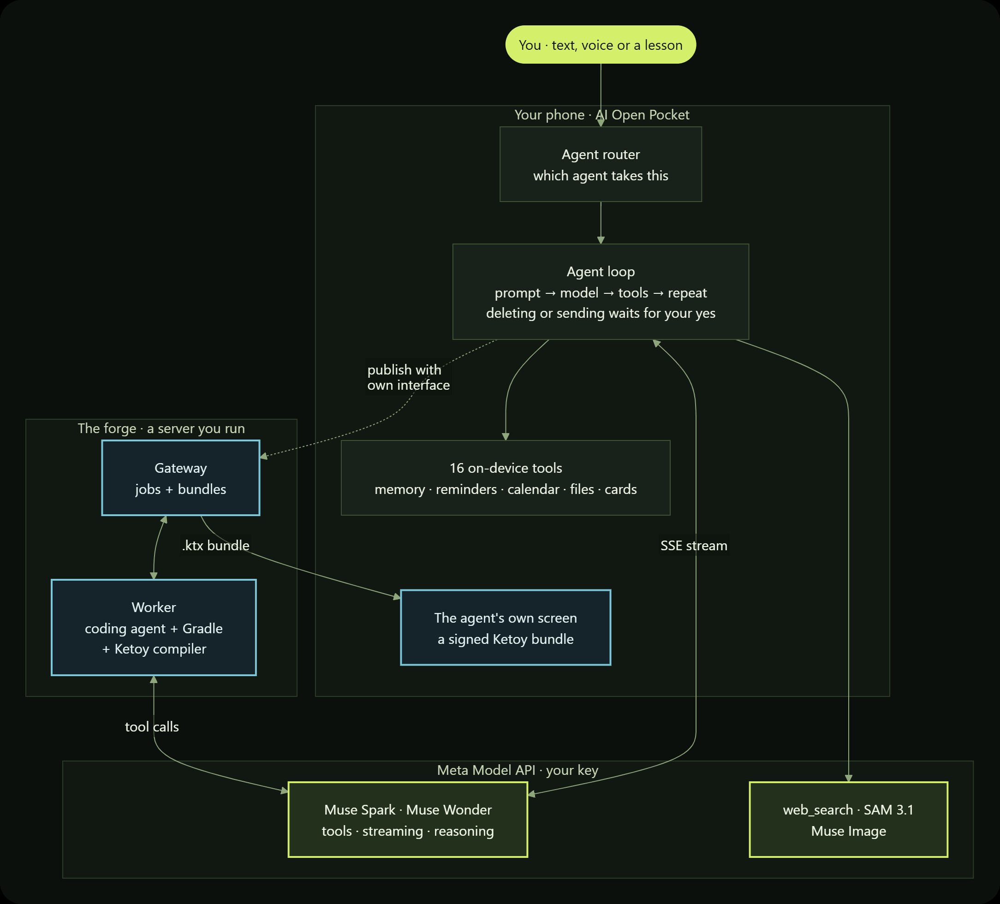
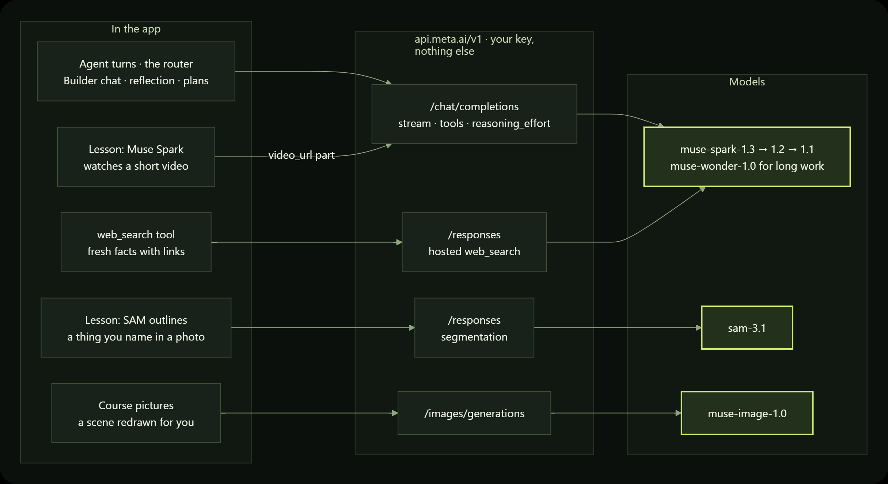
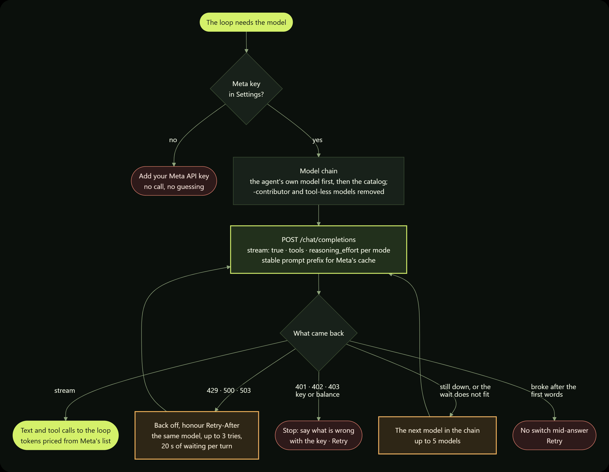
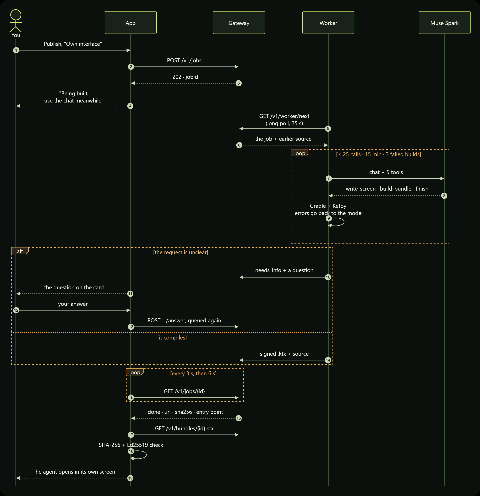
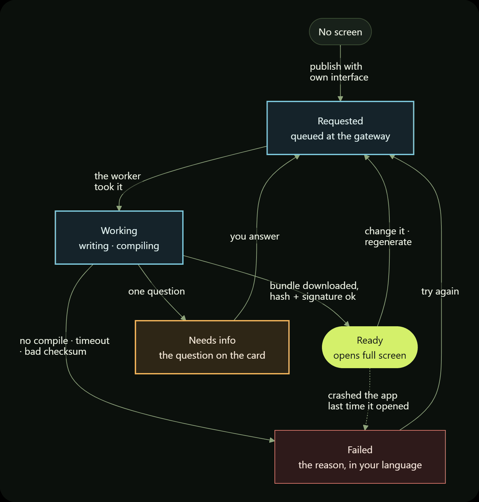

<div align="center">

# AI Open Pocket

**Build your first AI agent on Meta's models, right on your phone —<br/>for everyone curious about
agents but too shy to ask.**


<br/>

&nbsp;
&nbsp;
&nbsp;


<sub>Home · a lesson you can touch · your agents · the builder</sub>

<details>
<summary>More screens</summary>
<br/>
&nbsp;
&nbsp;

</details>

<br/>

[How it fits together](#how-it-fits-together) ·
[The agent loop](#the-agent-loop) ·
[Working with Meta](#working-with-meta) ·
[Screens from the cloud](#screens-from-the-cloud) ·
[Build and run](#build-and-run)

</div>

AI Open Pocket is an Android platform for building AI agents on Meta's Muse models, with learning
built in. Remember the "For Dummies" books of the 90s? They didn't lecture you about Windows — they
walked you through using it. This does the same for AI agents: you don't read about an agent, you
build one, and it does real things on your own phone.

There is no one to feel silly in front of — you ask the model, not a person. And there is nothing to
break: a dry run simulates every action, and anything that deletes data or leaves the phone waits
for your yes.

## What it does

- 🛠️ **Build.** Describe the agent in a chat: Muse Spark asks a few questions at a time, with 3–4
  options to tick, and writes the draft. Review every field on one screen, dry-run it, publish.
- 🤖 **Run.** Agents live on the phone: a tool-calling loop, layered memory, web search, reminders,
  background check-ins, and a plan engine whose steps are checked against evidence.
- 🧭 **Just ask.** The home chat and the voice assistant need no agent picked: Muse Spark hands each
  message to the agent whose job it is ("remind me…" goes to Reminders), or answers itself.
- 🎙️ **Talk to it.** The app can be the phone's voice assistant: the assist button opens a chat that
  is already listening, and the answer is read aloud.
- ☁️ **Give it an interface.** Tick "Own interface (beta)" when you publish: a coding agent on Muse
  writes the agent a screen of its own in Compose, in the cloud, and the app renders it over the air.
  No app update.
- 🎓 **Learn.** 31 short lessons, from "what is an AI" to building your own agent, each with an
  interactive scene you can touch. Meta's models work live inside some of them.
- 🔒 **Stay in control.** Reading and writing just happen. Deleting or sending anything off the device
  always asks you in chat, and is never done in the background.

## How it fits together

Three places, one key. **The phone** runs the agents: the router, the loop, the tools and your
approvals all live in the app, and so does your data. **Meta's Model API** is the only place a model
runs; the app talks to nothing else, on the key you entered. **The forge** is optional: a small
server you run yourself, where a coding agent on the same Muse model writes screens for your agents.

<p align="center"></p>

## The agent loop

Every message becomes one *turn*. The same loop runs for every agent — the model thinks, calls tools,
reads their results, and repeats until it can answer.

<p align="center"></p>

Step by step:

1. **The turn belongs to the app, not to the screen.** A turn manager in the application scope owns
   the stream, the tool loop and the final write to the database. Leave the chat, lock the phone —
   the answer is there when you come back, and a turn that needs you sends a notification.
2. **Who answers.** A chat opened from an agent's card is bound to that agent. The home chat and the
   voice assistant are not, so before the turn starts the **router** makes one short Muse Spark call
   (low reasoning effort, no tools, 8 seconds at most): it sees each agent's name, job and tools and
   names one id, or `none`. Anything else — an unknown id, two ids, a timeout, an error — means the
   plain assistant answers; routing is never the reason a message goes unanswered. The chip next to
   the mode chips can also fix the choice: "auto", "no agent" or one agent. The answer is labelled
   "→ Reminders", so you see who took it.
3. **The prompt is assembled from stable to volatile:** base rules, language, the agent's role, the
   catalog of its skills, its instructions, then the plan, the current time and what memory recalls.
   The order is deliberate: Meta caches the shared prefix, so the stable part is not paid for twice.
4. **The mode decides the shape of the turn.** Chat goes straight to the model. Reflect drafts,
   critiques and revises (the revision may only read). Plan asks a planner for steps and shows them as
   a card you approve or edit. Goal runs an approved plan step by step, and each step is checked
   against what the tools actually returned before it counts as done.
5. **The model streams text and tool calls.** Text appears as it is written; tool calls are collected
   and run between rounds.
6. **Every tool call passes the agent's rules and the execution policy.** Each tool has a risk class:
   `READ`, `WRITE`, `DESTRUCTIVE` or `EXTERNAL`. Reads and writes run on the phone with validated JSON
   arguments and a timeout. Deleting or sending off the phone waits for your "yes" in the chat; no rule
   can remove that floor, and a background run simply denies it. A dry run simulates everything but
   reads.
7. **Errors go back to the model as results.** A failed tool, a timeout or arguments that are not
   valid JSON return a message that names the real problem, so the next call can fix it.
8. **Every run ends with an answer.** After 10 rounds the model gets one last call without tools to
   say what is done and what is not.

### What an agent is made of

An agent is one immutable snapshot. Editing and publishing again produces a new version, so a turn
that is already running never sees half an edit.

<p align="center"></p>

The tools: memory, the agent's own storage, files, files you pick on the phone, database, UI cards,
notifications and reminders, background check-ins, scheduled work, calendar, alarm, email drafts,
step counter, spaced-repetition cards, web search, and loading a skill. A new agent starts with none,
and each risky one needs your explicit consent.

And this is how one gets from an idea to your roster:

<p align="center"></p>

The Builder can only write a draft. Publishing is always a person tapping a button.

## Working with Meta

Every model call goes to the **Meta Model API** (`api.meta.ai/v1`) on the key you enter, and nowhere
else. There is no other provider, no bundled key and no silent switch to another vendor.

<p align="center"></p>

- **Muse Spark** is the brain of every agent: the tool loop, reflection, plans, the router, the
  Builder chat, onboarding and every lesson question. In the "How a model sees" lesson it also
  watches a short video and says what it saw and what it is unsure about.
- **Muse Wonder** — an agent built for long multi-step work can run on it instead, as Meta's agent
  guide suggests. The model is the agent's own setting; the app default is automatic.
- **Web search** is Meta's hosted `web_search` tool, reached through the Responses API: an agent gets
  fresh facts back with the pages they came from, and quotes them as links.
- **SAM 3.1** — in the same lesson you name one thing in a photo (yours or a bundled example) and SAM
  outlines every instance of it.
- **Muse Image** illustrates the course (generated ahead of time and bundled, so lessons work
  offline) and redraws a lesson scene around the learner on request.

### One model call

<p align="center"></p>

- **No key, no call.** Without a key every model action says "add your Meta API key" and points to
  Settings. The app does not guess and does not fall back to anything.
- **A chain of Meta models, not of vendors:** `muse-spark-1.3`, `1.2`, `1.1` and `muse-wonder-1.0`,
  with the agent's own model first. Model versions the vendor trains on (`-contributor`) and models
  without tool calling are removed from the chain wherever it is built.
- **Transient errors are retried the way Meta's error guide says.** 429, 500 and 503 ask the same
  model again with exponential backoff and honour `Retry-After`, up to three tries and 20 seconds of
  waiting per turn. Only then does the chain move to the next model, five at most.
- **Some errors stop at once.** A rejected key or an empty balance (401, 402, 403) would fail on every
  model, so the turn stops and says what is wrong with the key. And once the first words of an answer
  are on screen, the app never switches model mid-answer; you get a Retry button instead.
- **Reasoning effort per mode:** `low` for lesson questions and the router, `medium` for chat, `high`
  for planning and self-critique.
- **Every call is metered.** Meta reports tokens; the app prices them from Meta's price list (the
  cached part of the prompt at its own price, web searches and SAM pictures per call) and shows the
  week's spend on your Profile.

<details>
<summary><b>Following Meta's agent guidance</b></summary>

The agent loop was checked against the Meta Model API docs (tool calling, reasoning, prompt caching,
error handling, agent frameworks) and the Muse Code permission model:

- **Stable prompt prefix.** The system prompt runs from stable to volatile, so Meta's automatic prefix
  cache survives from turn to turn.
- **Reasoning effort per mode,** instead of leaving the level to the model.
- **Every run ends with an answer.** At the step limit the model gets one tool-less call to say what is
  done and what is not.
- **Errors the model can act on.** A failed tool, a timeout or arguments that are not valid JSON go back
  to the model as a tool result that names the real problem; 429/5xx back off and honour `Retry-After`
  before falling back to another model.
- **Approval before side effects.** Destructive and external tools always wait for the person, hooks
  cannot remove that floor, background runs never take destructive or external actions, and a test
  run of a new agent simulates every side effect unless you switch it to live.
- **Least privilege in the builder.** A new agent starts with no tools; each risky tool needs explicit
  consent, and the Instructions step checks the prompt against Meta's prompting guide (role, format,
  length, tone).
- **The right model for the job.** A built agent can run on Muse Wonder (long multi-step work) or
  Muse Spark (faster and cheaper).

</details>

### Your key, your quota

- **Enter your own Meta Model API key in onboarding or in Settings. Nothing is bundled.** The key is
  stored in `EncryptedSharedPreferences` behind an Android Keystore master key and goes only to Meta.
- No key lives in this repository, and no key is compiled into any build, debug included: the build
  has no step that copies `.env` or anything else into `BuildConfig`. `tools/check.py` fails if one
  ever comes back, and scans the built APK for provider keys.

## Screens from the cloud

A chat is not the right interface for every agent. A water tracker wants eight glasses to tap, a
budget agent wants a few numbers and a button. So an agent built on the phone can get **a screen of
its own, written by another agent, delivered without an app update.**

On the builder's review page you choose where the agent lives: in the chat, or in its **own interface
(beta)**. Publish, and the rest happens on its own:

<p align="center"></p>

**The gateway** (`forge/gateway`, Ktor, runs on Fly.io or locally) is a job queue and a bundle store
with two bearer tokens: one for the app, one for the worker. It never runs a model.

**The worker** (`forge/worker`) is a JVM app on any machine with the Android SDK. It long-polls the
gateway for the next job and hands it to **the coding agent**: our own tool-calling loop on Muse
Spark, the same ReAct shape as the agent loop on the phone, with five tools instead of phone tools —
`list_files`, `read_file`, `write_screen`, `build_bundle`, `finish`. The model sees the agent's name,
description and instructions, the Ketoy catalog of what may be used, and its rules in
[`forge/AGENTS.md`](forge/AGENTS.md).

- **Every limit lives in code, not in the prompt:** 25 model calls, 15 minutes, three failed builds in
  a row, three replies that call no tool. Whichever trips first ends the job as failed, with the tail
  of the last build log, so you see why.
- **The compiler is the reviewer.** `build_bundle` runs Gradle and the [Ketoy](https://ketoy.dev)
  compiler; the first error goes back to the model as the tool's result, and it fixes the code.
- **Rules learned the hard way are enforced before the build.** Ketoy interprets the screen at run
  time, and some code compiles but crashes the interpreter: ranges like `0..7`, `toFloat()`, nullable
  values, lambda parameters. `write_screen` rejects them before the build, with a sentence that says
  what to write instead.
- **One question, if it really needs one.** When the request is unclear the agent finishes with
  `needs_info`; the question appears on the agent's card, your answer queues the job again.
- **Changes build on the last screen.** An update such as "add a reset button" sends the current
  source back to the agent, so it edits rather than starts over; Regenerate starts from scratch.

**The phone** never trusts a download it cannot check:

- The gateway reports the bundle's SHA-256; a download that does not match is refused.
- The worker signs every bundle with an Ed25519 key that lives only on the worker machine. The app
  ships the public key; a bundle signed with anything else renders the app's own fallback, not the
  screen.
- A crash sentinel guards the interpreter. Compose has no error boundary, so a flag is written right
  before the bundle renders and cleared once it has loaded. If the process dies in between, the next
  launch shows "this screen crashed the app" with Try again and Remove, not a crash loop.
- Polling runs in the application scope, like turns: every 3 seconds, then every 6, and it gives up
  after 15 minutes or 5 network failures in a row.

<p align="center"></p>

Once the screen is **Ready**, the agent opens in it, full screen, with the chat one tap away. The
agent's card keeps the controls: the Chat / Interface switch, Update (describe a change), Regenerate,
Remove, and the agent's question if it has one.

What has to agree on both sides: the Ketoy version (0.4.20-alpha), the forge's public key (shipped in
the app's assets) and the entry-point name the worker reports. The gateway address and token are
yours, entered in Settings; nothing is bundled into any build. The forge is a separate Gradle build in
[`forge/`](forge/README.md) because the Ketoy compiler plugin pins Kotlin 2.0.21 while the app is on
Kotlin 2.3; the app only needs Ketoy's runtime.

<sub>All diagrams are drawn from Mermaid sources in <a href="docs/diagrams"><code>docs/diagrams/</code></a>.</sub>

## Build and run

Prerequisites: [Android Studio](https://developer.android.com/studio) with JDK 21, and an emulator or
a device on Android 7.0+.

1. Clone the repository and open it in Android Studio.
2. Run the `app` configuration.
3. In the app, paste your **Meta Model API** key: onboarding asks for it right before the first step
   that calls a model (you can skip and add it later in **Settings → API key**). Get one at
   [dev.meta.ai](https://dev.meta.ai/docs/quickstart).
4. For English, open **Settings → Language → English**.

There is no `.env` to fill in: the build reads no key.

From the command line:

```bash
./gradlew :app:assembleDebug
./gradlew :app:testDebugUnitTest
```

For screens from the cloud, run the gateway and a worker as described in
[`forge/README.md`](forge/README.md), then enter the gateway address and token in Settings.

## Project layout

All app code is in the `app` module, under `app/src/main/java/com/aiopenpocket/`:

| Package | What lives there |
| --- | --- |
| `agent/loop` | One agent turn: the tool-calling loop, reflection, plan orchestration, `TurnManager` (turns survive leaving the chat screen) |
| `agent/core/llm` | Streaming client for Meta Model API, web search, SAM, Muse Image, the model catalog, Meta pricing |
| `agent/core/agent` | User-built agents and the agent router |
| `agent/core/mcp`, `agent/tools` | On-device tools: JSON schemas, validation, risk classes, the approval flow |
| `agent/core/plan` | The structured plan engine |
| `agent/core/skill`, `hook`, `policy` | Skills, rules (hooks) and the execution policy |
| `agent/core/memory`, `profile`, `prompt` | Memory layers, user profile, prompt assembly |
| `agent/core/forge`, `ui/forge` | Screens from the cloud: the gateway client, job state, the Ketoy host |
| `agent/core/lesson` | Lessons as strict step contracts in chat |
| `agent/workers` | WorkManager: reminders and background check-ins |
| `voice` | The voice assistant session |
| `ui/` | Jetpack Compose screens: chat, agents and the builder, the course, profile, settings |
| `i18n/` | Interface language: Russian and English side by side in one `tr(ru, en)` call |

Lessons are JSON in `app/src/main/assets/lessons/`; the model catalog is in
`app/src/main/assets/config/`. The forge (`contract`, `gateway`, `worker`, `screens`) is its own
Gradle build in `forge/`.

## Traceability

`traceability.yaml` lists every feature with the reason it exists, and `@trace <id>` markers tie it to
the code. `traxer check` runs before each commit and flags features without code, broken links and
code that changed since its reason was last confirmed.

## Stack

Kotlin, Jetpack Compose, Metro DI, Ktor (SSE streaming), Room, WorkManager, Coil, Ketoy. Tests: JUnit,
Robolectric and Roborazzi screenshot tests; `.github/workflows/android.yml` builds the app and runs
them.

## Before and during the hackathon

The Meta Global AI Developer Hackathon window is Oct 27 – Nov 4, 2026. Dates are in git:
`git log --since=2026-10-27` lists what was built inside the window.

**Before (up to Oct 26).** The platform already existed: the agent loop with tools and memory, the
step-by-step builder, the lesson engine with its interactive scenes, and the plan engine. Meta models
arrived on Oct 23–26: Muse Spark through OpenRouter, course images by Muse Image, the video lesson on
Muse Spark, the four lessons about Meta's models, a first direct Meta Model API route, and the English
interface on the demo path with three lessons translated.

**During (Oct 27 – Nov 4).**

- **Meta Model API only.** OpenRouter and every bundled key are gone. Chat, Muse Image and video input
  all go to `api.meta.ai` on the key the person enters (`95368fd7`, `e5e760f4`).
- **SAM 3.1** in "How a model sees": name a thing in a photo and SAM outlines every instance of it
  (`ebf5cb5d`).
- **The Builder chat.** Describe the agent in a chat with a hidden Builder agent on Muse Spark, then
  review every field on one screen (`f651ae72`, `d16accc0`). An agent passport pinned above the chat
  shows the agent as it is being built, read from the stored draft (what it does, can use, remembers,
  asks first, how it thinks); the Builder also asks about memory, permissions and planning, and the
  last card publishes after a confirmation (`9aa5131a`). Deleting your own agent is a clear button
  with a confirmation (`e8229519`).
- **Meta's agent guidance.** Everything under "Following Meta's agent guidance" above: prompt order for
  the prefix cache, reasoning effort per mode, an answer at the step limit, errors the model can act on,
  the prompting checklist, Wonder or Spark per agent, capped self-wakeups (`cf749c45`..`1901653d`).
- **Web search** through Meta's hosted `web_search` tool, always with sources (`80ba8d30`).
- **Voice assistant.** The app can be the phone's assistant (`58a9b17f`). The assist button opens a
  translucent sheet over whatever app is on screen: an orb listens, the question goes to the right
  agent, and the answer is shown in place and read aloud, with "Open in chat" (`c65274aa`).
- **Voice call.** A call with the assistant from any chat: it listens phrase by phrase, answers
  aloud sentence by sentence while the model is still writing, and the whole call stays in the chat
  (`7476fdcb`).
- **Photos in chat.** Attach a photo from the gallery or the camera; Muse Spark sees it, and only the
  newest photo is sent again on later turns (`6d27ebea`).
- **The agent router.** The home chat and the voice assistant hand each message to the right agent
  (`90dd818a`).
- **Screens from the cloud.** A coding agent on Muse Spark writes an agent its own screen, delivered
  as a signed Ketoy bundle (`f9cff965`, merged in `42ff285a`).
- **The whole course in English**: 31 lessons and their scenes, up from 3 (`c3192b51`..`391c5eff`).
  Every lesson on the Path now opens in any order (`2b4aad50`).
- **Profile**: the person's own data and what the assistant remembers about them (`8b2bd280`).
- **Skill market.** A market of agents and skills on the forge gateway, contributed by Uros Basaric:
  publishing, search, installs, reports, covers by Muse Image and a safety review of every package by
  Muse Spark (`7fddb6a6`). In the app, the builder picks a skill from it and shows the review and the
  full instruction before adding it (`1ce2b0ac`).
- **Fixes from device runs on Android 9 and 14**, among them: a request that expired unseen in the
  background is no longer reported as declined (`1f0305a7`), and Allow approves exactly what was shown
  (`2de101bf`).
- **The orchestrator** and the one check command `tools/check.py`.

## How it was built

A coordinating agent ran the work in short cycles. It split the roadmap into tasks of one to three
hours, gave each to an implementer agent in its own git worktree, had an independent verifier try to
fail the result, and merged only what passed. `python tools/check.py` grades the project against the
acceptance criteria in one command, and `traxer check` keeps every feature in `traceability.yaml` tied
to its code. The coordinator's working notes are kept out of this repository.

The history was rewritten before publication and once more on Nov 3, 2026, to drop those notes.
Commit dates are unchanged.

## License

[MIT](LICENSE).
