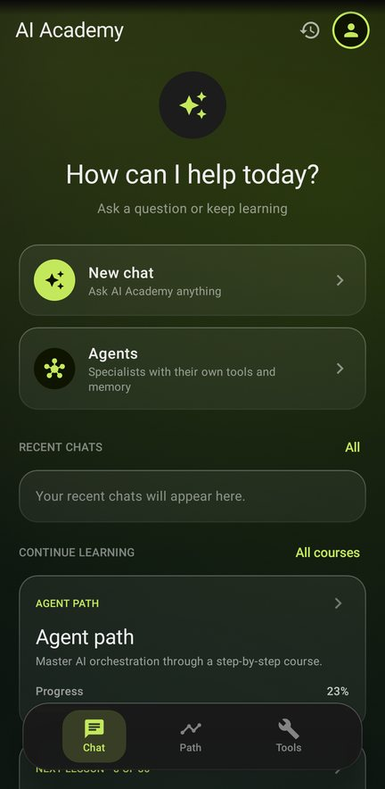
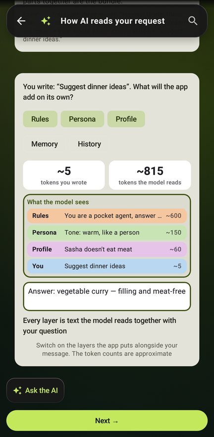
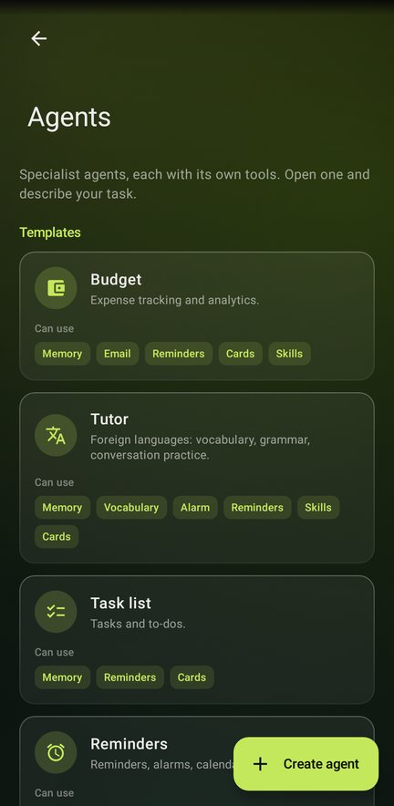
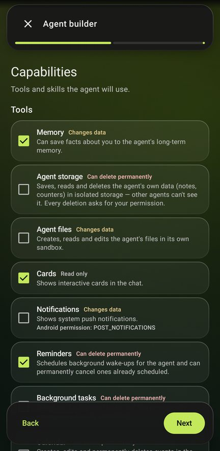
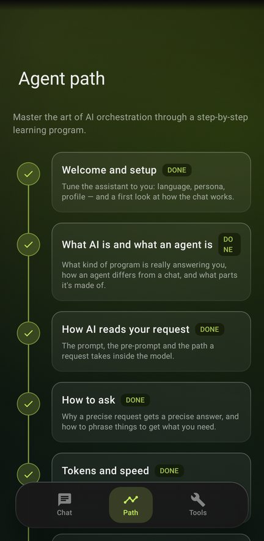
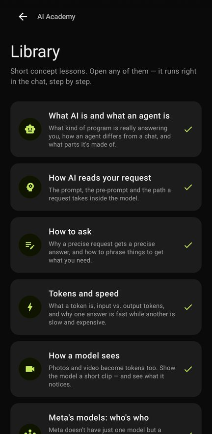
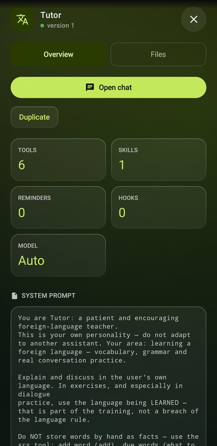
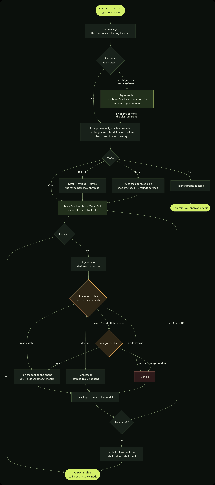
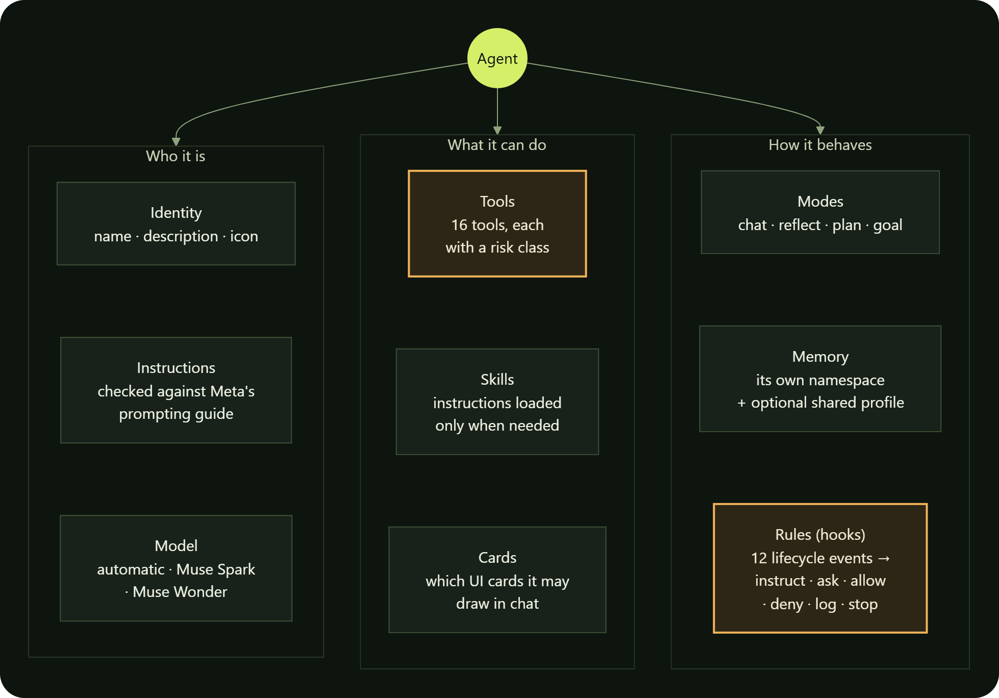
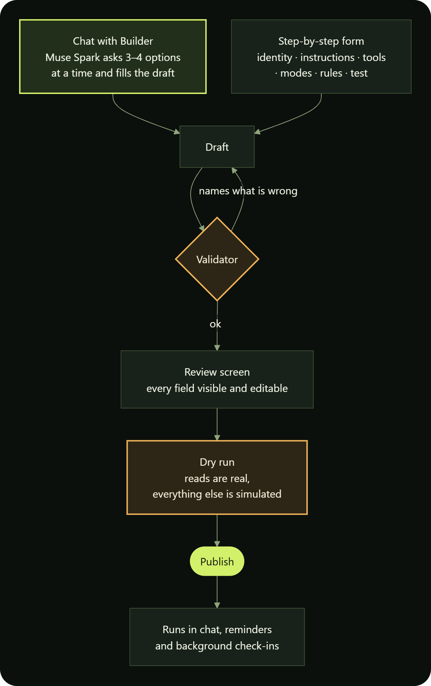

<div align="center">

# AI Open Pocket

**Build your first AI agent on Meta's models, right on your phone —<br/>for everyone curious about
agents but too shy to ask.**


<br/>

&nbsp;
&nbsp;
&nbsp;


<sub>Home · a lesson you can touch · your agents · the builder</sub>

<details>
<summary>More screens</summary>
<br/>
&nbsp;
&nbsp;

</details>

</div>

AI Open Pocket is an Android platform for building AI agents on Meta's Muse models, with learning
built in. Remember the "For Dummies" books of the 90s? They didn't lecture you about Windows — they
walked you through using it. This does the same for AI agents: you don't read about an agent, you
build one, and it does real things on your own phone.

There is no one to feel silly in front of — you ask the model, not a person. And there is nothing to
break: a dry run simulates every action, and anything that deletes data or leaves the phone waits
for your yes.

## What it does

- 🛠️ **Build.** Describe the agent in a chat: Muse Spark asks a few questions at a time, with 3–4
  options to tick, and writes the draft. Review every field on one screen, dry-run it, publish.
- 🤖 **Run.** Agents live on the phone: a tool-calling loop, layered memory, web search, reminders,
  background check-ins, and a plan engine whose steps are checked against evidence.
- 🎓 **Learn.** 31 short lessons, from "what is an AI" to building your own agent, each with an
  interactive scene you can touch. Meta's models work live inside some of them.
- 🔒 **Stay in control.** Reading and writing just happen. Deleting or sending anything off the device
  always asks you in chat, and is never done in the background.
- ☁️ **Give it an interface.** Tick "Own interface (beta)" when you publish an agent: a coding agent on
  Muse writes it a screen of its own in Compose, in the cloud, and the app renders it over the air.
  No app update.

## How an agent turn works

Every message you send becomes one *turn*. The turn belongs to the app, not to the screen: leave the
chat and it keeps going. Inside, the same loop runs for every agent — the model thinks, calls tools,
reads their results, and repeats until it can answer.

<p align="center"></p>

Four things keep this loop honest:

- **Risk classes.** Every tool call is `READ`, `WRITE`, `DESTRUCTIVE` or `EXTERNAL`. The last two
  always wait for a person, no rule can remove that floor, and a background run simply denies them.
- **Errors the model can act on.** A failed tool, a timeout or arguments that are not valid JSON come
  back as a tool result that names the real problem, so the model can fix its next call.
- **Every run ends with an answer.** At the round limit the model gets one tool-less call to say what
  it did and what is left.
- **Plans are checked.** In Goal mode each plan step is verified against what the tools actually
  returned before it counts as done.

## What an agent is made of

An agent is one immutable snapshot. Editing and publishing again produces a new version, so a turn
that is already running never sees half an edit.

<p align="center"></p>

The tools: memory, the agent's own storage, files, files you pick on the phone, database, UI cards,
notifications and reminders, background check-ins, scheduled work, calendar, alarm, email drafts,
step counter, spaced-repetition cards, web search, and loading a skill. A new agent starts with none,
and each risky one needs your explicit consent.

And this is how one gets from an idea to your roster:

<p align="center"></p>

The Builder can only write a draft. Publishing is always a person tapping a button.

<sub>The diagrams are drawn from Mermaid sources in <a href="docs/diagrams"><code>docs/diagrams/</code></a>.</sub>

## Cloud-forged screens

An agent built on the phone can get a screen of its own without an app update. On the review page
of the builder you choose where the agent lives: in the chat, or in its **own interface (beta)**.
Publish, and the app queues a job at the **forge gateway** from the agent's name, description and
instructions; the chat says "your interface is being built - use the chat meanwhile" and keeps
working. A **worker** on a machine with the Android SDK runs our own tool-calling loop on Muse
Spark - the same ReAct shape as the agent loop, with file and Gradle tools instead of phone tools -
until one minimal screen compiles; the [Ketoy](https://ketoy.dev) compiler turns it into a signed
bundle; the app downloads the bundle, checks its hash and signature, and from then on opens the
agent in that screen, full screen, with the chat one tap away. The agent's card keeps the levers:
the Chat / Own interface switch, "add a reset button" (the worker gets the current source back),
Regenerate, and the agent's own question if the request was unclear.

```
phone ──POST job──▶ gateway (Ktor, Fly.io) ◀──long-poll── worker (Muse Spark + Gradle + Ketoy)
      ◀─poll/.ktx──                        ──.ktx──────▶
```

What has to agree on both sides: the forge's Ed25519 public key (shipped in the app's assets), the
Ketoy version, and the entry-point name the worker reports. The gateway token and address are yours,
entered in Settings; nothing is bundled into any build. The forge itself is a separate Gradle build
in [`forge/`](forge/README.md): the compiler plugin pins Kotlin 2.0.21, the app stays on Kotlin 2.3.

## Built on Meta models

- **Muse Spark** — the brain of every agent: the tool loop, reflection, plans, the Builder chat,
  onboarding and every lesson question. In the "How a model sees" lesson it also watches a short video
  and explains what it saw and what it is unsure about.
- **Muse Wonder** — an agent built for long multi-step work can run on it instead, as Meta's agent
  guide suggests.
- **Web search** — Meta's hosted `web_search` tool, reached through the Responses API, gives agents
  fresh facts with links to the pages they came from.
- **Muse Image** — illustrates the course (generated ahead of time and bundled, so lessons work
  offline) and redraws a lesson scene around the learner on request.
- **SAM 3.1** — in the same lesson you name one thing in a photo (yours or a bundled example) and SAM
  outlines every instance of it.

Every model call goes to the **Meta Model API** (`api.meta.ai`) and nowhere else: `muse-spark-1.3`,
`muse-spark-1.2`, `muse-spark-1.1` and `muse-wonder-1.0`. Fallback happens only between those models.
Model variants that the vendor trains on (`-contributor`) are filtered out everywhere. Without a key
the app does not guess or fall back: every model action says "add your Meta API key" and points to
Settings.

<details>
<summary><b>Following Meta's agent guidance</b></summary>

The agent loop was checked against the Meta Model API docs (tool calling, reasoning, prompt caching,
error handling, agent frameworks) and the Muse Code permission model:

- **Stable prompt prefix.** The system prompt runs from stable to volatile (base, language, role,
  skills, instructions, then plan, current time, memory), so Meta's automatic prefix cache survives
  from turn to turn.
- **Reasoning effort per mode.** Lesson questions run at `low`, chat at `medium`, planning and
  self-critique at `high`, instead of leaving the level to the model.
- **Every run ends with an answer.** At the step limit the model gets one tool-less call to say what is
  done and what is not.
- **Errors the model can act on.** A failed tool, a timeout or arguments that are not valid JSON go back
  to the model as a tool result that names the real problem; 429/5xx back off and honour `Retry-After`
  before falling back to another model.
- **Approval before side effects.** Destructive and external tools always wait for the person, hooks
  cannot remove that floor, background runs never take destructive or external actions, and a test
  run of a new agent simulates every side effect unless you switch it to live.
- **Least privilege in the builder.** A new agent starts with no tools; each risky tool needs explicit
  consent, and the Instructions step checks the prompt against Meta's prompting guide (role, format,
  length, tone).
- **The right model for the job.** A built agent can run on Muse Wonder (long multi-step work) or
  Muse Spark (faster and cheaper), as Meta's agent guide suggests.

</details>

## Your key, your quota

- **Enter your own Meta Model API key in onboarding or in Settings. Nothing is bundled.** The key is
  stored in `EncryptedSharedPreferences` behind an Android Keystore master key and goes only to Meta.
- No key lives in this repository, and no key is compiled into any build, debug included: the build
  has no step that copies `.env` or anything else into `BuildConfig`. `tools/check.py` fails if one
  ever comes back, and scans the built APK for provider keys.
- Every model call is metered in a weekly spend card on your Profile. Meta reports tokens only, so the
  app prices Meta calls (and each web search) from Meta's price list.

## Build and run

Prerequisites: [Android Studio](https://developer.android.com/studio) with JDK 21, and an emulator or
a device on Android 7.0+.

1. Clone the repository and open it in Android Studio.
2. Run the `app` configuration.
3. In the app, paste your **Meta Model API** key: onboarding asks for it right before the first step
   that calls a model (you can skip and add it later in **Settings → API key**). Get one at
   [dev.meta.ai](https://dev.meta.ai/docs/quickstart).
4. For English, open **Settings → Language → English**.

There is no `.env` to fill in: the build reads no key.

From the command line:

```bash
./gradlew :app:assembleDebug
./gradlew :app:testDebugUnitTest
```

## Project layout

All code is in the `app` module, under `app/src/main/java/com/aiopenpocket/`:

| Package | What lives there |
| --- | --- |
| `agent/loop` | One agent turn: the tool-calling loop, reflection, plan orchestration, `TurnManager` (turns survive leaving the chat screen) |
| `agent/core/llm` | Streaming client for Meta Model API, web search, the model catalog, Meta pricing |
| `agent/core/mcp`, `agent/tools` | On-device tools: JSON schemas, validation, risk classes, the approval flow |
| `agent/core/plan` | The structured plan engine |
| `agent/core/agent`, `skill`, `hook`, `policy` | User-built agents, skills, rules (hooks) and the execution policy |
| `agent/core/memory`, `profile`, `prompt` | Memory layers, user profile, prompt assembly |
| `agent/core/lesson` | Lessons as strict step contracts in chat |
| `agent/workers` | WorkManager: reminders and background check-ins |
| `ui/` | Jetpack Compose screens: chat, agents and the builder, the course, profile, settings |
| `i18n/` | Interface language: Russian and English side by side in one `tr(ru, en)` call |

Lessons are JSON in `app/src/main/assets/lessons/`; the model catalog is in
`app/src/main/assets/config/`.

## Traceability

`traceability.yaml` lists every feature with the reason it exists, and `@trace <id>` markers tie it to
the code. `traxer check` runs before each commit and flags features without code, broken links and
code that changed since its reason was last confirmed.

## Stack

Kotlin, Jetpack Compose, Metro DI, Ktor (SSE streaming), Room, WorkManager, Coil. Tests: JUnit,
Robolectric and Roborazzi screenshot tests; `.github/workflows/android.yml` builds the app and runs
them.

## How it was built

`orchestrator/` holds the working notes of the agent that coordinated the work: the acceptance criteria
(`CRITERIA.md`), the roadmap, and a journal of every cycle, including what was checked on a device and
what was not. `python tools/check.py` grades the project against those criteria in one command.

Before publication the history was rewritten once to drop an old build artifact. Commit hashes quoted
inside `orchestrator/` refer to the earlier private history; `orchestrator/COMMIT_MAP.txt` maps each of
them to its commit here.

## License

[MIT](LICENSE).
