# Stage 1: Engine Spin — Детальный план реализации

**Проект:** OpenClaw — Android AI-агент  
**Стейдж:** Stage 1 (Engine Spin)  
**Длительность:** 10 дней (2 рабочие недели)  
**Цель:** Работающий агент-луп на мобильном устройстве — пользователь пишет в чат, агент стримит ответ, вызывает инструменты, показывает карточки, помнит контекст.

---

## 1. Обзор Stage 1

### 1.1 Что строим и зачем

Stage 1 — это фундамент всего проекта OpenClaw. Мы строим **Agent Engine** — ядро агентного цикла, которое превращает "чат-бот" в полноценного AI-агента, способного мыслить (Reasoning), действовать (Acting — вызывать инструменты) и помнить (Memory). Без этих трёх китов мы не сможем строить более сложные фичи в последующих стейджах.

Ключевой принцип Stage 1: **"Полноценный агент-луп на мобиле"**. Это означает, что всё критическое работает локально на устройстве: память (Room БД), файловая система, уведомления, планировщик задач. В сеть уходят только LLM-запросы через SSE-стриминг. Даже при потере интернета агент помнит контекст, может работать с локальными данными и покажет пользователю осмысленный ответ.

### 1.2 Что будет работать после Stage 1

- **Чат с AI-агентом** с полноценным стримингом ответов (SSE → Flow → Compose UI)
- **Function calling (14 инструментов):** чтение/запись файлов, поиск, уведомления, планировщик задач, работа с БД, управление памятью, веб-поиск, рендеринг карточек
- **ReAct-цикл:** агент может делать до 10 итераций "думаю → вызываю инструмент → анализирую результат → думаю дальше"
- **Memory:** агент помнит факты, эпизоды и историю всех чатов через Room (survives process death)
- **Multi-chat:** несколько независимых чатов с переключением
- **DivKit-карточки:** шаблоны (todo, weather, timer, table, chart, form) с fallback на markdown
- **Tool trace:** пользователь видит, какие инструменты вызывал агент (collapsible UI)
- **Markdown-рендеринг:** заголовки, списки, таблицы, цитаты, код-блоки через mikepenz multiplatform-markdown-renderer
- **Security:** API-ключи хранятся в EncryptedSharedPreferences через Keystore
- **Background tasks:** WorkManager для отложенных задач (schedule_task)

### 1.3 Что НЕ входит в Stage 1

| Фича | Когда | Почему не в Stage 1 |
|------|-------|---------------------|
| Voice input/output | Stage 2 | Требует отдельного research по STT/TTS |
| Image generation / vision | Stage 2 | Другой API-формат, отдельный дизайн UI |
| MCP servers (external) | Stage 3 | Сначала встроенные тулзы, потом внешние |
| Settings / onboarding | Stage 2 | Можно ввести API-ключ через shell первые 2 недели |
| Sync / cloud backup | Stage 4 | Локальная работа приоритетнее |
| Plugin system | Stage 3 | Архитектура должна стабилизироваться |

### 1.4 Definition of Done (для всего стейджа)

- [ ] Пользователь открывает приложение → видит список чатов → создаёт новый чат → пишет сообщение
- [ ] Агент стримит текстовый ответ в реальном времени (SSE → Flow → UI)
- [ ] Агент вызывает инструменты (tool trace виден в UI), получает результат, продолжает диалог
- [ ] Инструмент `schedule_task` создаёт нативное Android-уведомление в назначенное время
- [ ] Инструмент `remember_fact` сохраняет факт → агент вспоминает его в следующих сообщениях
- [ ] Инструмент `render_card` показывает DivKit-карточку в чате (с fallback на markdown)
- [ ] При process death и перезапуске все чаты и сообщения на месте (Room persistence)
- [ ] Unit tests проходят (FakeLlmClient, in-memory Room): Agent Loop, Tool execution, Pre-prompt assembly
- [ ] Нет ANR, нет runBlocking в main thread, все корутины в правильных scope'ах
- [ ] APK size < 50 MB (с DivKit, Room, Compose)

---

## 2. Архитектура системы

### 2.1 Общая схема компонентов

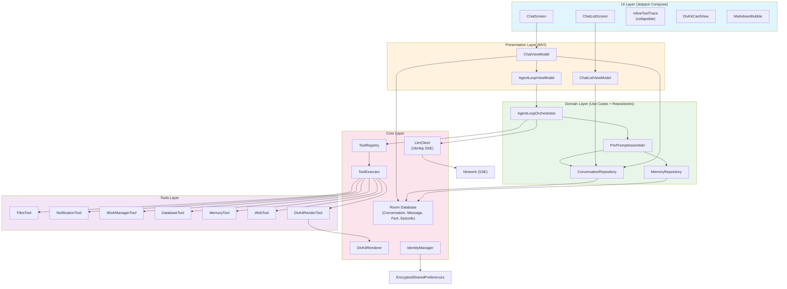

### 2.2 Поток данных: User Message → Agent Loop → UI Update

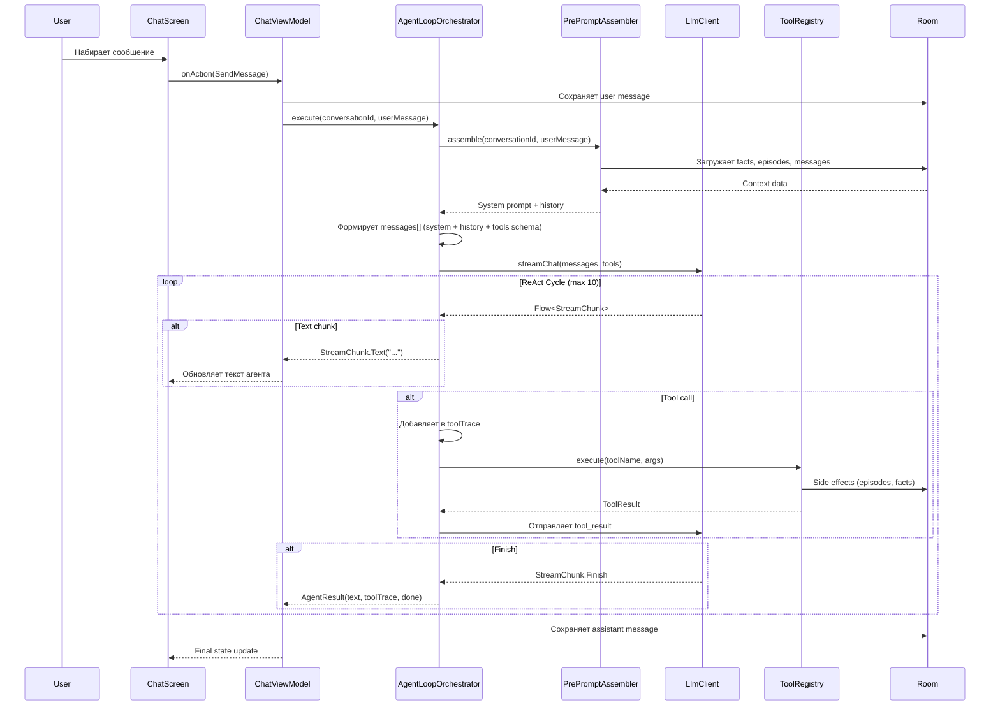

### 2.3 ReAct цикл: диаграмма итераций

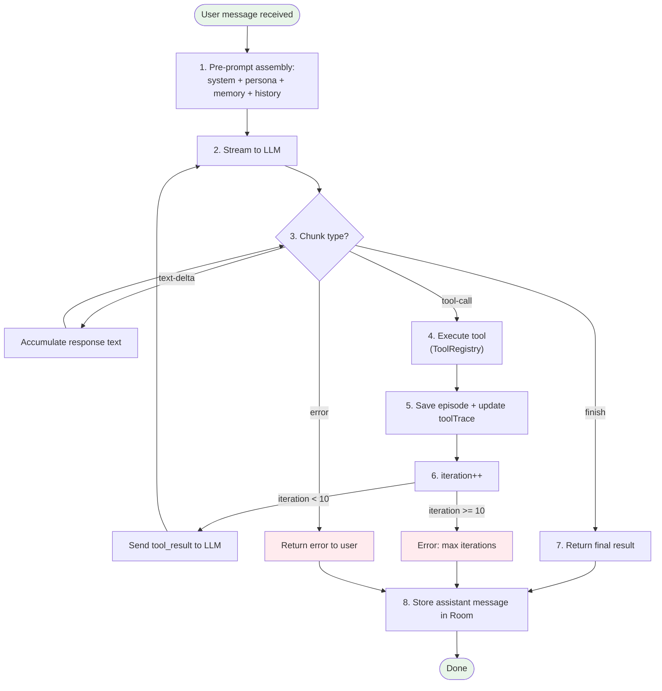

### 2.4 Pre-prompt assembly: что входит в system prompt

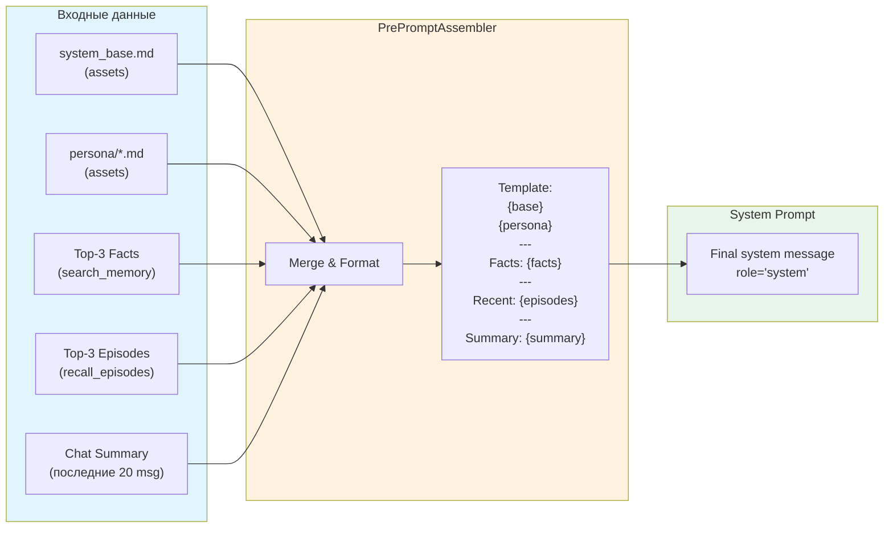

### 2.5 Архитектурные принципы

- **MVI (Model-View-Intent):** каждый экран имеет immutable `State`, `Action` (user intent) и `ViewModel` с `StateFlow<State>`. Однонаправленный поток данных: User → Action → ViewModel → State → UI.
- **Repository Pattern:** все данные проходят через Repository (ConversationRepository, MemoryRepository). ViewModel не знает про Room напрямую.
- **Use Cases:** бизнес-логика агента (AgentLoopOrchestrator, PrePromptAssembler) — это use cases, которые координируют repositories и core-сервисы.
- **Dependency Injection:** Hilt связывает всё. Каждый модуль Gradle предоставляет `@Module` с `@InstallIn(SingletonComponent::class)`.
- **Coroutines + Flow:** SSE-стриминг → `Flow<StreamChunk>`, UI-state → `StateFlow`, one-time events → `SharedFlow`.

---

## 3. Gradle-модули

### 3.1 Структура

```
agent/
├── app/                    # Compose UI, DI graph (Hilt), ViewModels
│   ├── src/main/java/com/openclaw/app/
│   │   ├── MainActivity.kt
│   │   ├── OpenClawApp.kt               # @HiltAndroidApp
│   │   ├── navigation/
│   │   ├── di/
│   │   │   └── AppModule.kt             # Binds ViewModels, Repositories
│   │   ├── presentation/
│   │   │   ├── chatlist/
│   │   │   │   ├── ChatListScreen.kt
│   │   │   │   ├── ChatListViewModel.kt
│   │   │   │   └── ChatListState.kt
│   │   │   ├── chat/
│   │   │   │   ├── ChatScreen.kt
│   │   │   │   ├── ChatViewModel.kt
│   │   │   │   ├── ChatState.kt
│   │   │   │   ├── components/
│   │   │   │   │   ├── MessageBubble.kt
│   │   │   │   │   ├── ToolTracePanel.kt
│   │   │   │   │   ├── DivKitCard.kt
│   │   │   │   │   └── MarkdownText.kt
│   │   │   │   └── ChatInput.kt
│   │   │   └── agentloop/
│   │   │       └── AgentLoopViewModel.kt
│   │   └── theme/
│   └── build.gradle.kts    # :app depends on all core/* and tools/*
│
├── core/
│   ├── llm/
│   │   ├── src/main/java/com/openclaw/core/llm/
│   │   │   ├── LlmClient.kt
│   │   │   ├── StreamingParser.kt
│   │   │   ├── model/
│   │   │   │   ├── StreamChunk.kt           # sealed class
│   │   │   │   ├── ChatMessage.kt
│   │   │   │   ├── ToolCall.kt
│   │   │   │   └── ToolSchema.kt
│   │   │   ├── provider/
│   │   │   │   ├── ProviderConfig.kt        # NIM, Groq, GitHub Models
│   │   │   │   └── ProviderFallbackChain.kt
│   │   │   └── sse/
│   │   │       └── SseEventSource.kt        # OkHttp EventSource wrapper
│   │   └── build.gradle.kts # OkHttp, coroutines, json
│   │
│   ├── mcp/
│   │   ├── src/main/java/com/openclaw/core/mcp/
│   │   │   ├── ToolRegistry.kt
│   │   │   ├── ToolExecutor.kt
│   │   │   ├── model/
│   │   │   │   ├── Tool.kt                  # name, description, schema, execute
│   │   │   │   ├── ToolResult.kt            # sealed class
│   │   │   │   └── ToolTrace.kt
│   │   │   └── schema/
│   │   │       └── JsonSchemaValidator.kt   # networknt/json-schema-validator
│   │   └── build.gradle.kts
│   │
│   ├── agent-loop/
│   │   ├── src/main/java/com/openclaw/core/agentloop/
│   │   │   ├── AgentLoopOrchestrator.kt
│   │   │   ├── ReActCycle.kt
│   │   │   ├── model/
│   │   │   │   ├── AgentResult.kt
│   │   │   │   ├── AgentState.kt            # idle, thinking, executing_tool
│   │   │   │   └── Iteration.kt
│   │   │   └── cancellation/
│   │   │       └── AgentCancellation.kt
│   │   └── build.gradle.kts # depends on :core:llm, :core:mcp, :core:memory, :core:preprompt
│   │
│   ├── memory/
│   │   ├── src/main/java/com/openclaw/core/memory/
│   │   │   ├── entity/
│   │   │   │   ├── Conversation.kt          # @Entity
│   │   │   │   ├── Message.kt               # @Entity
│   │   │   │   ├── Fact.kt                  # @Entity
│   │   │   │   └── Episode.kt               # @Entity
│   │   │   ├── dao/
│   │   │   │   ├── ConversationDao.kt
│   │   │   │   ├── MessageDao.kt
│   │   │   │   ├── FactDao.kt
│   │   │   │   └── EpisodeDao.kt
│   │   │   ├── database/
│   │   │   │   └── OpenClawDatabase.kt
│   │   │   ├── repository/
│   │   │   │   ├── MemoryRepository.kt
│   │   │   │   └── ConversationRepository.kt
│   │   │   └── di/
│   │   │       └── MemoryModule.kt
│   │   └── build.gradle.kts # Room, coroutines
│   │
│   ├── divkit-renderer/
│   │   ├── src/main/java/com/openclaw/core/divkit/
│   │   │   ├── DivKitRenderer.kt
│   │   │   ├── SafeRenderPipeline.kt
│   │   │   ├── schema/
│   │   │   │   ├── DivSchemaValidator.kt
│   │   │   │   └── CardTemplateLoader.kt    # Загружает шаблоны из assets
│   │   │   ├── fallback/
│   │   │   │   └── MarkdownFallback.kt
│   │   │   └── compose/
│   │   │       └── DivKitComposeAdapter.kt  # AndroidView wrapper
│   │   └── build.gradle.kts # Yandex DivKit
│   │
│   ├── preprompt/
│   │   ├── src/main/java/com/openclaw/core/preprompt/
│   │   │   ├── PrePromptAssembler.kt
│   │   │   ├── loader/
│   │   │   │   ├── AssetLoader.kt
│   │   │   │   └── PersonaLoader.kt
│   │   │   └── model/
│   │   │       └── PrePromptContext.kt
│   │   └── build.gradle.kts # depends on :core:memory
│   │
│   └── identity/
│       ├── src/main/java/com/openclaw/core/identity/
│       ├── ApiKeyManager.kt
│       ├── KeystoreHelper.kt
│       └── EncryptedStorage.kt
│       └── build.gradle.kts # security-crypto, androidx.security
│
├── tools/
│   ├── files/
│   │   ├── FilesTool.kt                     # read_file, write_file, list_dir, search_files
│   │   └── build.gradle.kts
│   ├── notifications/
│   │   ├── NotificationTool.kt              # send_notification
│   │   └── build.gradle.kts
│   ├── work/
│   │   ├── WorkManagerTool.kt               # schedule_task, cancel_task
│   │   └── build.gradle.kts
│   ├── db/
│   │   ├── DatabaseTool.kt                  # query_db, insert_db
│   │   └── build.gradle.kts
│   ├── memory-tools/
│   │   ├── MemoryTool.kt                    # remember_fact, search_memory, recall_episodes
│   │   └── build.gradle.kts
│   ├── web/
│   │   ├── WebTool.kt                       # web_search, web_fetch
│   │   └── build.gradle.kts
│   └── render/
│       ├── DivKitRenderTool.kt              # render_card tool + DivKit integration
│       └── build.gradle.kts
│
└── data/
    └── src/main/assets/
        ├── system_base.md
        ├── personas/
        │   ├── default.md
        │   ├── coder.md
        │   └── assistant.md
        └── schemas/
            ├── todo_list.json
            ├── weather_card.json
            ├── timer.json
            ├── table.json
            ├── chart_bar.json
            └── form.json
```

### 3.2 Зависимости между модулями

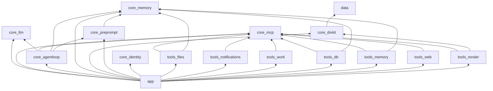

### 3.3 Базовые `build.gradle.kts` зависимости

```kotlin
// Все core-модули
implementation("org.jetbrains.kotlinx:kotlinx-coroutines-core:1.8.0")
implementation("org.jetbrains.kotlinx:kotlinx-coroutines-android:1.8.0")
implementation("org.jetbrains.kotlinx:kotlinx-serialization-json:1.6.3")

// :app
implementation("androidx.core:core-ktx:1.12.0")
implementation("androidx.lifecycle:lifecycle-runtime-ktx:2.7.0")
implementation("androidx.lifecycle:lifecycle-viewmodel-compose:2.7.0")
implementation("androidx.activity:activity-compose:1.8.2")
implementation(platform("androidx.compose:compose-bom:2024.02.00"))
implementation("androidx.compose.ui:ui")
implementation("androidx.compose.material3:material3")
implementation("androidx.navigation:navigation-compose:2.7.7")
implementation("com.google.dagger:hilt-android:2.50")
implementation("androidx.hilt:hilt-navigation-compose:1.1.0")
kapt("com.google.dagger:hilt-compiler:2.50")
implementation("com.mikepenz:multiplatform-markdown-renderer:0.41.0")
implementation("com.mikepenz:multiplatform-markdown-renderer-m3:0.41.0")

// :core:llm
implementation("com.squareup.okhttp3:okhttp:4.12.0")
implementation("com.squareup.okhttp3:okhttp-sse:4.12.0")

// :core:mcp
implementation("com.networknt:json-schema-validator:1.3.3")

// :core:memory
implementation("androidx.room:room-runtime:2.6.1")
implementation("androidx.room:room-ktx:2.6.1")
kapt("androidx.room:room-compiler:2.6.1")

// :core:divkit-renderer
implementation("com.yandex.div:div:30.4.0")
implementation("com.yandex.div:div-json:30.4.0")
implementation("com.yandex.div:div-core:30.4.0")

// :core:identity
implementation("androidx.security:security-crypto:1.1.0-alpha06")

// :tools:work
implementation("androidx.work:work-runtime-ktx:2.9.0")
implementation("androidx.hilt:hilt-work:1.1.0")
```

---

## 4. Компоненты — детальное описание

### 4.1 Agent Core (LlmClient)

**Зачем:** Ядро коммуникации с LLM. Единственный компонент, который ходит в сеть. Отвечает за SSE-стриминг, function calling формат, multi-provider fallback и retry-логику.

**Ключевые классы:**

```kotlin
// StreamChunk — sealed class для всех типов чанков из SSE
sealed class StreamChunk {
    data class TextDelta(val content: String) : StreamChunk()
    data class ToolCall(
        val id: String,
        val name: String,
        val arguments: Map<String, JsonElement>
    ) : StreamChunk()
    data class Finish(val reason: String) : StreamChunk()
    data class Error(val message: String, val code: String? = null) : StreamChunk()
}

// ChatMessage — формат сообщения для LLM API
@Serializable
data class ChatMessage(
    val role: String,  // "system", "user", "assistant", "tool"
    val content: String? = null,
    val toolCalls: List<ToolCall>? = null,
    val toolCallId: String? = null,
)

// ToolSchema — JSON Schema для function calling
@Serializable
data class ToolSchema(
    val type: String = "function",
    val function: FunctionSchema
) {
    @Serializable
    data class FunctionSchema(
        val name: String,
        val description: String,
        val parameters: JsonObject
    )
}

// LlmClient — основной интерфейс
interface LlmClient {
    fun streamChat(
        messages: List<ChatMessage>,
        tools: List<ToolSchema>,
        provider: Provider = Provider.AUTO
    ): Flow<StreamChunk>
}

// StreamingLlmClient — реализация с OkHttp SSE
class StreamingLlmClient @Inject constructor(
    private val fallbackChain: ProviderFallbackChain,
    private val parser: StreamingParser
) : LlmClient {
    
    override fun streamChat(
        messages: List<ChatMessage>,
        tools: List<ToolSchema>,
        provider: Provider
    ): Flow<StreamChunk> = flow {
        val providers = fallbackChain.resolve(provider)
        var lastError: Exception? = null
        
        for (p in providers) {
            try {
                val request = buildRequest(p, messages, tools)
                val eventSource = createEventSource(request)
                
                eventSource.collect { event ->
                    parser.parse(event).let { emit(it) }
                }
                return@flow // Успех — выходим
            } catch (e: Exception) {
                lastError = e
                continue // Пробуем следующий провайдер
            }
        }
        
        emit(StreamChunk.Error(
            "All providers failed. Last error: ${lastError?.message}"
        ))
    }.retry(3) { e ->
        delay((1000 * (attempt + 1)).toLong()) // Exponential backoff
        true
    }
}

// ProviderFallbackChain — цепочка провайдеров
class ProviderFallbackChain @Inject constructor(
    private val configs: Map<Provider, ProviderConfig>
) {
    fun resolve(requested: Provider): List<ProviderConfig> = when (requested) {
        Provider.AUTO -> listOf(configs[Provider.NIM]!!, configs[Provider.GROQ]!!, configs[Provider.GITHUB]!!)
        else -> listOf(configs[requested]!!)
    }
}

// ProviderConfig — конфигурация провайдера
data class ProviderConfig(
    val name: Provider,
    val baseUrl: String,
    val model: String,
    val apiKey: String,
    val maxRetries: Int = 3
)
```

**Поток данных:**

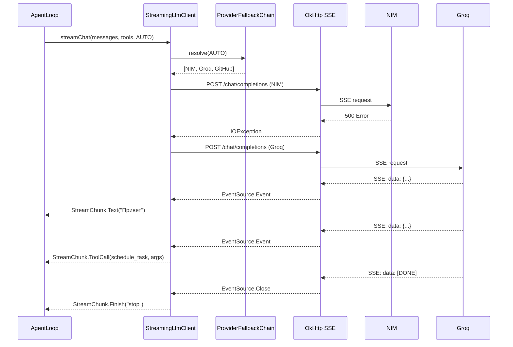

**Definition of Done:**
- [ ] SSE-стриминг работает стабильно (не падает при обрыве сети)
- [ ] Multi-provider fallback: при падении NIM → автоматически Groq → GitHub Models
- [ ] Retry с exponential backoff (1s, 2s, 4s) — max 3 попытки на провайдера
- [ ] Flow<StreamChunk> корректно эмитит все типы чанков
- [ ] Tool call парсится корректно (id, name, arguments)
- [ ] Unit tests с FakeLlmClient проходят

**Оценка:** 2 дня (День 1-2)

---

### 4.2 ToolRegistry / ToolExecutor

**Зачем:** Централизованная система регистрации и выполнения инструментов. Агент может вызывать тулзы по имени, Registry находит нужный executor, валидирует аргументы и возвращает результат. ToolResult всегда возвращает результат — даже при ошибке (never throws).

**Ключевые классы:**

```kotlin
// ToolResult — sealed class, всегда содержит результат
sealed class ToolResult {
    data class Success(val data: String, val metadata: Map<String, String> = emptyMap()) : ToolResult()
    data class Error(val message: String, val recoverable: Boolean = true) : ToolResult()
}

// Tool — интерфейс каждого инструмента
interface Tool {
    val name: String
    val description: String
    val schema: ToolSchema
    suspend fun execute(arguments: Map<String, JsonElement>): ToolResult
}

// ToolRegistry — регистрация и поиск
class ToolRegistry @Inject constructor(
    tools: Set<@JvmSuppressWildcards Tool>
) {
    private val toolMap = tools.associateBy { it.name }
    
    fun getTool(name: String): Tool? = toolMap[name]
    fun getAllTools(): List<Tool> = toolMap.values.toList()
    fun getAllSchemas(): List<ToolSchema> = toolMap.values.map { it.schema }
}

// ToolExecutor — валидация + выполнение
class ToolExecutor @Inject constructor(
    private val registry: ToolRegistry,
    private val validator: JsonSchemaValidator
) {
    suspend fun execute(name: String, arguments: Map<String, JsonElement>): ToolResult {
        val tool = registry.getTool(name)
            ?: return ToolResult.Error("Tool '$name' not found", recoverable = false)
        
        // Валидация аргументов по JSON Schema
        val validation = validator.validate(tool.schema.function.parameters, arguments)
        if (!validation.isValid) {
            return ToolResult.Error("Invalid arguments: ${validation.errors.joinToString()}")
        }
        
        return try {
            tool.execute(arguments)
        } catch (e: Exception) {
            ToolResult.Error("Execution failed: ${e.message}", recoverable = true)
        }
    }
}

// ToolTrace — история вызовов для UI
data class ToolTrace(
    val iteration: Int,
    val toolName: String,
    val arguments: Map<String, JsonElement>,
    val result: ToolResult,
    val timestamp: Long = System.currentTimeMillis()
)
```

**Поток данных:**

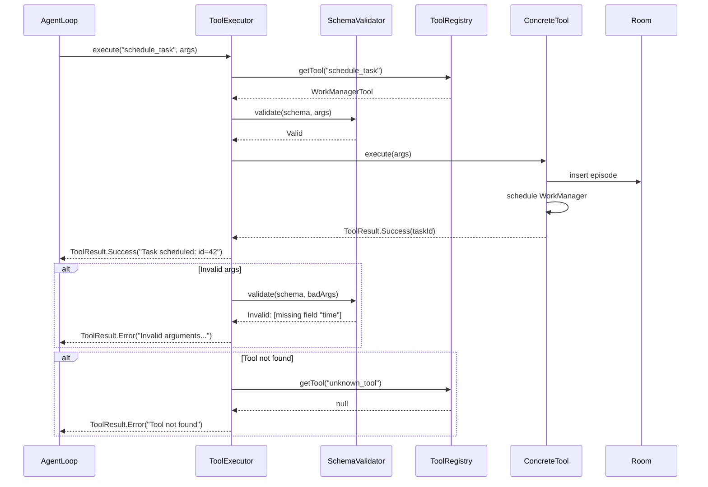

**Definition of Done:**
- [ ] 14 инструментов зарегистрированы и работают (список ниже)
- [ ] JSON Schema validation отклоняет невалидные аргументы
- [ ] ToolResult всегда возвращает результат, никогда не бросает exception
- [ ] ToolTrace собирается и передаётся в UI
- [ ] Каждый тул — отдельный класс, inject через Hilt multibinding
- [ ] Unit tests: каждый тул тестируется изолированно

**Список инструментов Stage 1:**

| # | Инструмент | Модуль | Описание |
|---|-----------|--------|----------|
| 1 | `read_file` | `:tools:files` | Читает файл по пути |
| 2 | `write_file` | `:tools:files` | Пишет в файл |
| 3 | `list_dir` | `:tools:files` | Список файлов в директории |
| 4 | `search_files` | `:tools:files` | Поиск по содержимому файлов |
| 5 | `send_notification` | `:tools:notifications` | Мгновенное уведомление |
| 6 | `schedule_task` | `:tools:work` | Отложенная задача (WorkManager) |
| 7 | `cancel_task` | `:tools:work` | Отмена задачи |
| 8 | `query_db` | `:tools:db` | SQL-запрос к локальной БД |
| 9 | `insert_db` | `:tools:db` | INSERT в локальную БД |
| 10 | `remember_fact` | `:tools:memory-tools` | Сохранить факт в память |
| 11 | `search_memory` | `:tools:memory-tools` | Поиск фактов по запросу |
| 12 | `recall_episodes` | `:tools:memory-tools` | Получить недавние эпизоды |
| 13 | `web_search` | `:tools:web` | Поиск в интернете |
| 14 | `web_fetch` | `:tools:web` | Загрузить страницу |
| 15 | `render_card` | `:tools:render` | Отрендерить DivKit карточку |

**Оценка:** 2 дня (День 3-4)

---

### 4.3 Agent Loop (ReAct)

**Зачем:** Мозг агента. ReAct-цикл (Reasoning + Acting) позволяет агенту делать несколько итераций: получил задачу → подумал → вызвал инструмент → получил результат → подумал снова → ... → дал финальный ответ. Max 10 итераций защищает от бесконечных циклов.

**Ключевые классы:**

```kotlin
// AgentState — текущее состояние агента
enum class AgentState {
    IDLE, STREAMING, EXECUTING_TOOL, FINISHED, ERROR
}

// AgentResult — результат работы агента
data class AgentResult(
    val text: String,
    val toolTrace: List<ToolTrace>,
    val state: AgentState,
    val iterations: Int
)

// AgentLoopOrchestrator — ReAct цикл
class AgentLoopOrchestrator @Inject constructor(
    private val llmClient: LlmClient,
    private val toolExecutor: ToolExecutor,
    private val prePromptAssembler: PrePromptAssembler,
    private val registry: ToolRegistry
) {
    companion object {
        const val MAX_ITERATIONS = 10
    }

    private var currentJob: Job? = null

    fun execute(
        conversationId: Long,
        userMessage: String
    ): Flow<AgentEvent> = flow {
        // 1. Собираем pre-prompt
        val context = prePromptAssembler.assemble(conversationId, userMessage)
        
        // 2. Формируем messages
        val messages = mutableListOf<ChatMessage>()
        messages += ChatMessage(role = "system", content = context.systemPrompt)
        messages += context.history.map { it.toChatMessage() }
        messages += ChatMessage(role = "user", content = userMessage)
        
        // 3. Получаем tool schemas
        val tools = registry.getAllSchemas()
        
        // 4. ReAct цикл
        val toolTrace = mutableListOf<ToolTrace>()
        var accumulatedText = ""
        
        for (iteration in 1..MAX_ITERATIONS) {
            emit(AgentEvent.StateChanged(AgentState.STREAMING))
            
            llmClient.streamChat(messages, tools).collect { chunk ->
                when (chunk) {
                    is StreamChunk.TextDelta -> {
                        accumulatedText += chunk.content
                        emit(AgentEvent.TextDelta(chunk.content))
                    }
                    is StreamChunk.ToolCall -> {
                        emit(AgentEvent.StateChanged(AgentState.EXECUTING_TOOL))
                        emit(AgentEvent.ToolStarted(chunk.name, chunk.arguments))
                        
                        // Выполняем инструмент
                        val result = toolExecutor.execute(chunk.name, chunk.arguments)
                        
                        val trace = ToolTrace(
                            iteration = iteration,
                            toolName = chunk.name,
                            arguments = chunk.arguments,
                            result = result
                        )
                        toolTrace.add(trace)
                        emit(AgentEvent.ToolCompleted(chunk.name, result))
                        
                        // Добавляем tool result в messages для следующей итерации
                        messages += ChatMessage(
                            role = "assistant",
                            content = null,
                            toolCalls = listOf(chunk)
                        )
                        messages += ChatMessage(
                            role = "tool",
                            toolCallId = chunk.id,
                            content = resultToString(result)
                        )
                    }
                    is StreamChunk.Finish -> {
                        emit(AgentEvent.StateChanged(AgentState.FINISHED))
                        emit(AgentEvent.Completed(AgentResult(
                            text = accumulatedText,
                            toolTrace = toolTrace,
                            state = AgentState.FINISHED,
                            iterations = iteration
                        )))
                        return@flow
                    }
                    is StreamChunk.Error -> {
                        emit(AgentEvent.StateChanged(AgentState.ERROR))
                        emit(AgentEvent.Error(chunk.message))
                        return@flow
                    }
                }
            }
        }
        
        // Max iterations reached
        emit(AgentEvent.Error("Max iterations ($MAX_ITERATIONS) reached"))
    }.flowOn(Dispatchers.IO)

    fun cancel() {
        currentJob?.cancel()
    }
}

// AgentEvent — sealed class для событий агента (для UI)
sealed class AgentEvent {
    data class TextDelta(val content: String) : AgentEvent()
    data class ToolStarted(val name: String, val args: Map<String, JsonElement>) : AgentEvent()
    data class ToolCompleted(val name: String, val result: ToolResult) : AgentEvent()
    data class StateChanged(val state: AgentState) : AgentEvent()
    data class Completed(val result: AgentResult) : AgentEvent()
    data class Error(val message: String) : AgentEvent()
}
```

**Поток данных (ReAct cycle):**

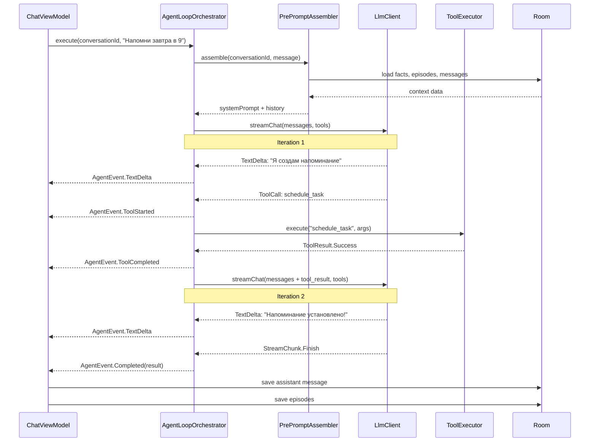

**Definition of Done:**
- [ ] ReAct цикл работает: LLM → tool call → execution → LLM → ... → finish
- [ ] Max 10 итераций — жёсткий лимит
- [ ] Tool trace собирается за все итерации
- [ ] Cancellation: новое сообщение от юзера отменяет текущий цикл
- [ ] Flow<AgentEvent> корректно эмитит все события в правильном порядке
- [ ] При ошибке LLM → fallback provider, не падает
- [ ] Unit tests: FakeLlmClient имитирует multi-iteration сценарии

**Оценка:** 2 дня (День 5-6)

---

### 4.4 DivKit Renderer

**Зачем:** Богатые карточки в чате (todo-листы, погода, таймеры, таблицы) вместо сухого markdown. DivKit от Yandex — нативный рендеринг JSON-шаблонов. Safe pipeline: валидация → рендеринг → fallback на markdown при ошибке.

**Ключевые классы:**

```kotlin
// DivKitRenderer — основной интерфейс
interface DivKitRenderer {
    fun render(json: JSONObject): RenderResult
}

// RenderResult — результат рендеринга
sealed class RenderResult {
    data class Success(val view: Div2View) : RenderResult()
    data class Fallback(val markdown: String, val error: String) : RenderResult()
}

// SafeRenderPipeline — pipeline валидации + рендеринга
class SafeRenderPipeline @Inject constructor(
    private val schemaValidator: DivSchemaValidator,
    private val templateLoader: CardTemplateLoader
) {
    fun render(templateName: String, params: Map<String, Any>): RenderResult {
        return try {
            // 1. Загружаем шаблон
            val template = templateLoader.load(templateName)
            
            // 2. Подставляем параметры
            val filled = fillTemplate(template, params)
            
            // 3. Валидируем JSON
            val validation = schemaValidator.validate(filled)
            if (!validation.isValid) {
                return RenderResult.Fallback(
                    markdown = params.toMarkdown(),
                    error = "Schema validation failed: ${validation.errors}"
                )
            }
            
            // 4. Рендерим через DivKit
            val divData = DivData(filled)
            val view = Div2View(context).apply {
                setData(divData)
            }
            
            RenderResult.Success(view)
        } catch (e: Exception) {
            RenderResult.Fallback(
                markdown = params.toMarkdown(),
                error = "Render error: ${e.message}"
            )
        }
    }
}

// DivKitComposeAdapter — AndroidView wrapper для Compose
@Composable
fun DivKitCard(
    templateName: String,
    params: Map<String, Any>,
    modifier: Modifier = Modifier
) {
    val renderer = LocalDivKitRenderer.current
    var result by remember { mutableStateOf<RenderResult?>(null) }
    
    LaunchedEffect(templateName, params) {
        result = renderer.render(templateName, params)
    }
    
    when (val r = result) {
        is RenderResult.Success -> {
            AndroidView(
                factory = { r.view },
                modifier = modifier
            )
        }
        is RenderResult.Fallback -> {
            // Fallback на markdown
            MarkdownText(text = r.markdown, modifier = modifier)
        }
        null -> {
            CircularProgressIndicator(modifier = modifier)
        }
    }
}

// CardTemplateLoader — загружает шаблоны из assets
class CardTemplateLoader @Inject constructor(
    private val assetManager: AssetManager
) {
    fun load(templateName: String): JSONObject {
        val path = "schemas/$templateName.json"
        val json = assetManager.open(path).bufferedReader().use { it.readText() }
        return JSONObject(json)
    }
}
```

**Поток данных:**

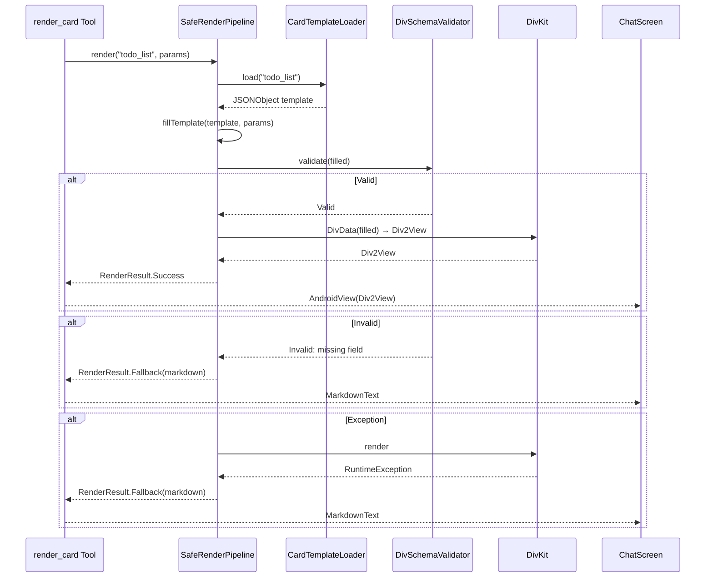

**Definition of Done:**
- [ ] 6 шаблонов карточек загружаются из assets: todo_list, weather_card, timer, table, chart_bar, form
- [ ] JSON Schema валидация отклоняет битые шаблоны
- [ ] Fallback на markdown работает при любой ошибке
- [ ] AndroidView wrapper корректно интегрируется в Compose
- [ ] Карточка отображается внутри пузыря сообщения
- [ ] Нет memory leaks (Div2View cleanup)

**Оценка:** 1.5 дня (День 7)

---

### 4.5 Memory (Room)

**Зачем:** Память агента. Всё сохраняется локально в SQLite через Room: чаты, сообщения, факты, эпизоды. Survives process death. Shared между чатами через PrePromptAssembler.

**Ключевые классы:**

```kotlin
// Conversation — чат
@Entity(tableName = "conversations")
data class Conversation(
    @PrimaryKey(autoGenerate = true) val id: Long = 0,
    val title: String,
    val createdAt: Long = System.currentTimeMillis(),
    val updatedAt: Long = System.currentTimeMillis(),
    val personaId: String = "default"
)

// Message — сообщение в чате
@Entity(
    tableName = "messages",
    foreignKeys = [
        ForeignKey(
            entity = Conversation::class,
            parentColumns = ["id"],
            childColumns = ["conversationId"],
            onDelete = ForeignKey.CASCADE
        )
    ],
    indices = [Index("conversationId")]
)
data class Message(
    @PrimaryKey(autoGenerate = true) val id: Long = 0,
    val conversationId: Long,
    val role: String,  // "user", "assistant", "system", "tool"
    val content: String,
    val toolCalls: String? = null,  // JSON serialized
    val createdAt: Long = System.currentTimeMillis()
)

// Fact — факт в долгосрочной памяти
@Entity(tableName = "facts")
data class Fact(
    @PrimaryKey(autoGenerate = true) val id: Long = 0,
    val key: String,           // "user.name", "user.preference.theme"
    val value: String,
    val category: String,      // "profile", "preference", "system"
    val confidence: Float = 1.0f,
    val createdAt: Long = System.currentTimeMillis(),
    val updatedAt: Long = System.currentTimeMillis()
)

// Episode — событие/эпизод в памяти
@Entity(tableName = "episodes")
data class Episode(
    @PrimaryKey(autoGenerate = true) val id: Long = 0,
    val type: String,          // "tool_call", "user_action", "milestone"
    val payload: String,       // JSON
    val outcome: String,       // Результат
    val timestamp: Long = System.currentTimeMillis()
)

// DAO
@Dao
interface MessageDao {
    @Query("SELECT * FROM messages WHERE conversationId = :id ORDER BY createdAt")
    fun getByConversation(id: Long): Flow<List<Message>>
    
    @Insert
    suspend fun insert(message: Message): Long
    
    @Query("SELECT * FROM messages WHERE conversationId = :id ORDER BY createdAt DESC LIMIT :limit")
    suspend fun getRecent(id: Long, limit: Int): List<Message>
}

@Dao
interface FactDao {
    @Query("SELECT * FROM facts WHERE category = :category")
    fun getByCategory(category: String): Flow<List<Fact>>
    
    @Query("SELECT * FROM facts WHERE `key` LIKE '%' || :query || '%' OR value LIKE '%' || :query || '%'")
    suspend fun search(query: String): List<Fact>
    
    @Insert(onConflict = OnConflictStrategy.REPLACE)
    suspend fun insert(fact: Fact): Long
}

@Dao
interface EpisodeDao {
    @Query("SELECT * FROM episodes ORDER BY timestamp DESC LIMIT :limit")
    suspend fun getRecent(limit: Int): List<Episode>
    
    @Query("SELECT * FROM episodes WHERE timestamp > :since ORDER BY timestamp DESC")
    suspend fun getSince(since: Long): List<Episode>
    
    @Insert
    suspend fun insert(episode: Episode): Long
}

// Repository
class MemoryRepository @Inject constructor(
    private val factDao: FactDao,
    private val episodeDao: EpisodeDao
) {
    fun searchFacts(query: String): Flow<List<Fact>> = flow {
        emit(factDao.search(query))
    }.flowOn(Dispatchers.IO)
    
    suspend fun getRecentEpisodes(limit: Int = 10): List<Episode> =
        episodeDao.getRecent(limit)
    
    suspend fun saveFact(key: String, value: String, category: String) {
        factDao.insert(Fact(key = key, value = value, category = category))
    }
    
    suspend fun saveEpisode(type: String, payload: String, outcome: String) {
        episodeDao.insert(Episode(type = type, payload = payload, outcome = outcome))
    }
}

// Database
@Database(entities = [Conversation::class, Message::class, Fact::class, Episode::class], version = 1)
abstract class OpenClawDatabase : RoomDatabase() {
    abstract fun conversationDao(): ConversationDao
    abstract fun messageDao(): MessageDao
    abstract fun factDao(): FactDao
    abstract fun episodeDao(): EpisodeDao
}
```

**Поток данных:**

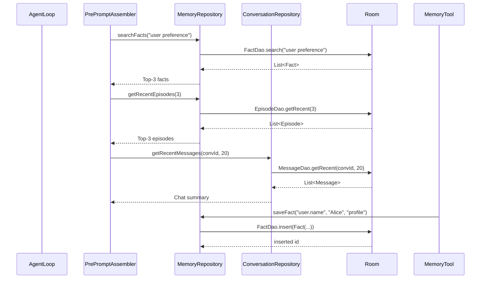

**Definition of Done:**
- [ ] Room database version 1 — все 4 entity созданы
- [ ] DAO работают: insert, query, Flow наблюдение
- [ ] ConversationRepository: CRUD + список с Flow
- [ ] MemoryRepository: searchFacts, getRecentEpisodes, saveFact, saveEpisode
- [ ] In-memory database для тестов (Room.inMemoryDatabaseBuilder)
- [ ] Foreign key constraint: удаление чата каскадно удаляет сообщения
- [ ] Schema version 1 — миграции пока не нужны

**Оценка:** 1 день (День 3)

---

### 4.6 Multi-chat

**Зачем:** Пользователь может вести несколько независимых диалогов с агентом. Каждый чат — Conversation со своим списком сообщений, персонажем и историей. Агент может использовать факты и эпизоды из всех чатов (shared memory).

**Ключевые классы:**

```kotlin
// ConversationRepository
class ConversationRepository @Inject constructor(
    private val conversationDao: ConversationDao,
    private val messageDao: MessageDao
) {
    fun getAllConversations(): Flow<List<Conversation>> =
        conversationDao.getAll()
    
    suspend fun createConversation(title: String, personaId: String = "default"): Long {
        return conversationDao.insert(Conversation(title = title, personaId = personaId))
    }
    
    fun getMessages(conversationId: Long): Flow<List<Message>> =
        messageDao.getByConversation(conversationId)
    
    suspend fun addMessage(conversationId: Long, role: String, content: String): Long {
        return messageDao.insert(Message(
            conversationId = conversationId,
            role = role,
            content = content
        ))
    }
    
    suspend fun deleteConversation(id: Long) {
        conversationDao.deleteById(id)
    }
}

// ChatListState (MVI)
data class ChatListState(
    val conversations: List<Conversation> = emptyList(),
    val isLoading: Boolean = false
)

sealed class ChatListAction {
    data class CreateChat(val title: String) : ChatListAction()
    data class DeleteChat(val id: Long) : ChatListAction()
    data class SelectChat(val id: Long) : ChatListAction()
}

// ChatListViewModel
@HiltViewModel
class ChatListViewModel @Inject constructor(
    private val repository: ConversationRepository
) : ViewModel() {
    
    private val _state = MutableStateFlow(ChatListState())
    val state: StateFlow<ChatListState> = _state.asStateFlow()
    
    init {
        viewModelScope.launch {
            repository.getAllConversations()
                .collect { conversations ->
                    _state.update { it.copy(conversations = conversations) }
                }
        }
    }
    
    fun onAction(action: ChatListAction) {
        when (action) {
            is ChatListAction.CreateChat -> createChat(action.title)
            is ChatListAction.DeleteChat -> deleteChat(action.id)
            is ChatListAction.SelectChat -> navigateToChat(action.id)
        }
    }
    
    private fun createChat(title: String) {
        viewModelScope.launch {
            val id = repository.createConversation(title)
            navigateToChat(id)
        }
    }
    
    private fun deleteChat(id: Long) {
        viewModelScope.launch {
            repository.deleteConversation(id)
        }
    }
}
```

**Definition of Done:**
- [ ] ChatListScreen: список чатов с превью последнего сообщения
- [ ] Создание нового чата ( FAB + диалог )
- [ ] Удаление чата (swipe-to-delete с подтверждением)
- [ ] ChatScreen: сообщения + input, привязка к conversationId
- [ ] При process death и перезапуске все чаты на месте
- [ ] Navigation Compose: ChatList → Chat с conversationId argument
- [ ] Новое сообщение от юзера отменяет текущий Agent Loop

**Оценка:** 1 день (День 8)

---

### 4.7 Markdown (mikepenz multiplatform-markdown-renderer)

**Зачем:** Богатый текст в пузырях чата — заголовки, списки, таблицы, цитаты, код. Заменяет обычный Text() на полноценный markdown-рендерер. Fallback для DivKit при ошибках рендеринга карточек.

**Ключевые классы:**

```kotlin
// MarkdownText — Compose компонент
@Composable
fun MarkdownText(
    text: String,
    modifier: Modifier = Modifier,
    style: TextStyle = MaterialTheme.typography.bodyLarge
) {
    val parser = remember { CommonmarkMarkdownParser() }
    val rendered = remember(text) { parser.parse(text) }
    
    RichText(
        modifier = modifier,
        style = RichTextStyle().copy(
            paragraphSpacing = TextUnit.Unspecified
        )
    ) {
        BasicMarkdown(
            content = rendered,
            markdownParseOptions = MarkdownParseOptions.Default
        )
    }
}

// Использование в MessageBubble
@Composable
fun MessageBubble(
    message: Message,
    isUser: Boolean,
    modifier: Modifier = Modifier
) {
    val backgroundColor = if (isUser) {
        MaterialTheme.colorScheme.primaryContainer
    } else {
        MaterialTheme.colorScheme.surfaceVariant
    }
    
    Box(
        modifier = modifier
            .padding(horizontal = 16.dp, vertical = 4.dp)
            .background(backgroundColor, RoundedCornerShape(16.dp))
            .padding(12.dp)
    ) {
        MarkdownText(text = message.content)
    }
}
```

**Definition of Done:**
- [ ] Заголовки (# ## ###) рендерятся корректно
- [ ] Списки (ordered/unordered) работают
- [ ] Таблицы отображаются
- [ ] Блоки кода с monospace шрифтом и background
- [ ] Цитаты (>) с indentation и accent color
- [ ] Fallback markdown при ошибке DivKit — текст читаемый
- [ ] Нет crash на malformed markdown

**Оценка:** 0.5 дня (День 8)

---

### 4.8 Pre-prompt Assembly

**Зачем:** Собирает system prompt для LLM из нескольких источников: базовые инструкции, персона, релевантные факты, недавние эпизоды, summary чата. Это даёт агенту контекст — он "знает" пользователя и помнит предыдущие взаимодействия.

**Ключевые классы:**

```kotlin
// PrePromptContext — контекст для сборки
data class PrePromptContext(
    val systemPrompt: String,
    val history: List<Message>
)

// PrePromptAssembler
class PrePromptAssembler @Inject constructor(
    private val assetLoader: AssetLoader,
    private val personaLoader: PersonaLoader,
    private val memoryRepository: MemoryRepository,
    private val conversationRepository: ConversationRepository
) {
    suspend fun assemble(
        conversationId: Long,
        currentMessage: String
    ): PrePromptContext {
        // 1. Базовый промпт
        val systemBase = assetLoader.loadString("system_base.md")
        
        // 2. Персона (default если не указана)
        val persona = personaLoader.load("default")
        
        // 3. Top-3 релевантных факта
        val facts = memoryRepository.searchFacts(currentMessage)
            .first()
            .sortedByDescending { it.confidence }
            .take(3)
        
        // 4. Top-3 недавних эпизода
        val episodes = memoryRepository.getRecentEpisodes(3)
        
        // 5. Последние 20 сообщений чата
        val messages = conversationRepository.getRecentMessages(conversationId, 20)
        
        // 6. Собираем финальный prompt
        val systemPrompt = buildString {
            appendLine(systemBase)
            appendLine()
            appendLine("## Persona")
            appendLine(persona)
            appendLine()
            appendLine("## Relevant Facts")
            facts.forEach { appendLine("- ${it.key}: ${it.value}") }
            appendLine()
            appendLine("## Recent Episodes")
            episodes.forEach { appendLine("- [${it.type}] ${it.outcome}") }
            appendLine()
            appendLine("## Instructions")
            appendLine("You have access to tools. Use them when needed.")
            appendLine("Think step by step. Be concise but helpful.")
        }
        
        return PrePromptContext(
            systemPrompt = systemPrompt,
            history = messages
        )
    }
}
```

**Поток данных:**

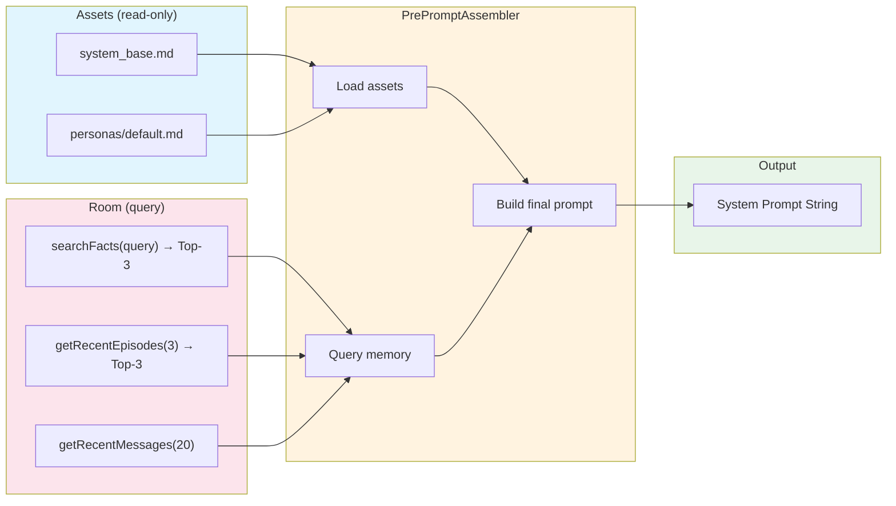

**Definition of Done:**
- [ ] system_base.md загружается из assets
- [ ] Persona загружается из assets/personas/
- [ ] Top-3 facts: search по текущему запросу, sorted by confidence
- [ ] Top-3 episodes: последние за 24-48 часов
- [ ] Последние 20 сообщений чата включены в history
- [ ] Финальный prompt корректно форматируется (markdown)
- [ ] Unit tests: mock MemoryRepository проверяют composition
- [ ] При пустой памяти prompt всё ещё валиден (no nulls)

**Оценка:** 0.5 дня (День 5)

---

### 4.9 Test Harness

**Зачем:** Быстрые и стабильные unit tests без зависимости от реального LLM и сети. FakeLlmClient возвращает предопределённые ответы. In-memory Room — быстрая БД для тестов.

**Ключевые классы:**

```kotlin
// FakeLlmClient — имитация LLM для тестов
class FakeLlmClient(
    private val responses: List<List<StreamChunk>> = emptyList()
) : LlmClient {
    private var callIndex = 0
    
    override fun streamChat(
        messages: List<ChatMessage>,
        tools: List<ToolSchema>,
        provider: Provider
    ): Flow<StreamChunk> = flow {
        if (callIndex < responses.size) {
            responses[callIndex].forEach { emit(it) }
            callIndex++
        } else {
            emit(StreamChunk.TextDelta("Default response"))
            emit(StreamChunk.Finish("stop"))
        }
    }
    
    // Builder для удобного создания сценариев
    class Builder {
        private val responses = mutableListOf<List<StreamChunk>>()
        
        fun addResponse(vararg chunks: StreamChunk) = apply {
            responses.add(chunks.toList())
        }
        
        fun addToolCall(name: String, args: Map<String, JsonElement>, 
                       thenText: String) = apply {
            responses.add(listOf(
                StreamChunk.ToolCall("call_1", name, args),
                StreamChunk.Finish("stop")
            ))
            responses.add(listOf(
                StreamChunk.TextDelta(thenText),
                StreamChunk.Finish("stop")
            ))
        }
        
        fun build() = FakeLlmClient(responses)
    }
}

// Test module для Hilt
@Module
@TestInstallIn(components = [SingletonComponent::class], replaces = [LlmModule::class])
object TestLlmModule {
    @Provides
    fun provideFakeLlmClient(): LlmClient = FakeLlmClient.Builder()
        .addResponse(StreamChunk.TextDelta("Hello!"), StreamChunk.Finish("stop"))
        .build()
}

// In-memory database для тестов
@Module
@TestInstallIn(components = [SingletonComponent::class], replaces = [MemoryModule::class])
object TestMemoryModule {
    @Provides
    @Singleton
    fun provideInMemoryDatabase(@ApplicationContext context: Context): OpenClawDatabase {
        return Room.inMemoryDatabaseBuilder(context, OpenClawDatabase::class.java)
            .allowMainThreadQueries() // Только для тестов
            .build()
    }
}

// Пример теста Agent Loop
@HiltAndroidTest
class AgentLoopTest {
    @Inject lateinit var orchestrator: AgentLoopOrchestrator
    @Inject lateinit var database: OpenClawDatabase
    
    @Before
    fun setup() {
        hiltRule.inject()
    }
    
    @After
    fun tearDown() {
        database.close()
    }
    
    @Test
    fun `simple text response`() = runTest {
        val events = orchestrator.execute(1L, "Hi").toList()
        
        assertTrue(events.any { it is AgentEvent.TextDelta })
        assertTrue(events.any { it is AgentEvent.Completed })
    }
    
    @Test
    fun `tool call and continue`() = runTest {
        // FakeLlmClient настроен на tool call в первом response
        // и текстовый ответ во втором
        val events = orchestrator.execute(1L, "Set a reminder").toList()
        
        val toolEvents = events.filterIsInstance<AgentEvent.ToolCompleted>()
        assertEquals(1, toolEvents.size)
        assertTrue(toolEvents[0].result is ToolResult.Success)
        
        val completed = events.filterIsInstance<AgentEvent.Completed>()
        assertEquals(1, completed.size)
    }
    
    @Test
    fun `max iterations limit`() = runTest {
        // FakeLlmClient всегда возвращает ToolCall (бесконечный цикл)
        val events = orchestrator.execute(1L, "Loop test").toList()
        
        val toolEvents = events.filterIsInstance<AgentEvent.ToolCompleted>()
        assertTrue(toolEvents.size <= 10)
    }
    
    @Test
    fun `cancellation works`() = runTest {
        val job = launch {
            orchestrator.execute(1L, "Slow request").collect()
        }
        
        delay(100)
        orchestrator.cancel()
        job.join()
        
        assertTrue(job.isCancelled)
    }
}
```

**Definition of Done:**
- [ ] FakeLlmClient имитирует текстовые ответы
- [ ] FakeLlmClient имитирует tool calls (multi-iteration)
- [ ] FakeLlmClient имитирует ошибки
- [ ] In-memory Room для тестов (no disk I/O)
- [ ] Unit tests: Agent Loop (simple response, tool call, max iterations, cancellation)
- [ ] Unit tests: Tool execution (success, validation error, tool not found)
- [ ] Unit tests: Pre-prompt assembly (composition, empty memory)
- [ ] Compose UI tests: ChatScreen (send message, see response)
- [ ] Все тесты проходят за < 10 секунд

**Оценка:** 1 день (День 9)

---

## 5. Sequence Diagram: Полный цикл

Ниже показан полный цикл от пользовательского сообщения до финального ответа агента с использованием инструмента `schedule_task`:

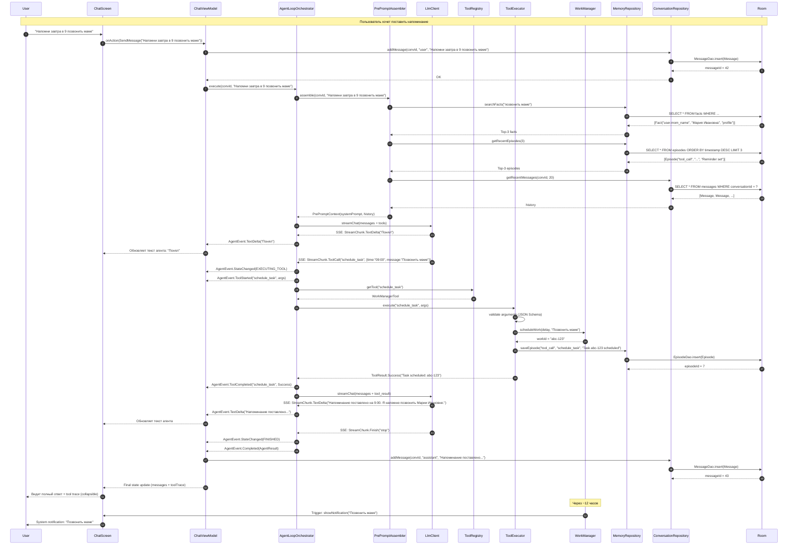

---

## 6. Расписание по дням

| День | Задачи | Компонент | Deliverable |
|------|--------|-----------|-------------|
| **1** | Gradle multi-module setup (`:app`, `:core:*`, `:tools:*`, `:data`), Hilt graph, Compose Material3 shell с bottom nav | `app` | Собирающийся проект с пустым экраном |
| **2** | Room entities (Conversation, Message, Fact, Episode), DAO, Database, DI module; in-memory DB builder для тестов | `memory` | CRUD операции, Flow наблюдение, тесты проходят |
| **3** | ToolRegistry Hilt multibinding, ToolExecutor с JSON Schema validation; реализация `read_file`, `write_file`, `list_dir`, `search_files` | `mcp`, `tools:files` | 4 тулза работают, валидация аргументов |
| **4** | Реализация оставшихся 10 тулзов: `send_notification`, `schedule_task`/`cancel_task` (WorkManager), `query_db`/`insert_db`, `remember_fact`/`search_memory`/`recall_episodes`, `web_search`/`web_fetch`, `render_card` | `tools:*` | Все 15 тулзов зарегистрированы и тестируются |
| **5** | LlmClient с OkHttp SSE, StreamingParser, ProviderFallbackChain; PrePromptAssembler с загрузкой assets | `llm`, `preprompt` | SSE → Flow<StreamChunk>, fallback chain, pre-prompt собирается |
| **6** | AgentLoopOrchestrator: ReAct цикл, tool trace, cancellation; интеграция с LlmClient + ToolRegistry + PrePromptAssembler | `agent-loop` | ReAct cycle работает (2+ итерации), tool trace собирается |
| **7** | DivKit Renderer: SafeRenderPipeline, JSON Schema validation, 6 шаблонов карточек, AndroidView wrapper, markdown fallback | `divkit-renderer`, `tools:render` | Карточки рендерятся, fallback работает |
| **8** | Multi-chat UI: ChatListScreen, ChatScreen, Navigation; Markdown рендеринг через mikepenz multiplatform-markdown-renderer; MessageBubble компонент | `app` | 2 экрана, переключение чатов, markdown в пузырях |
| **9** | Test Harness: FakeLlmClient, in-memory Room, unit tests для AgentLoop, Tool execution, Pre-prompt assembly; Compose UI тесты | `test` | >80% покрытие core-модулей, все тесты проходят |
| **10** | Identity (EncryptedSharedPreferences + Keystore), полировка UI, багфиксы, performance (APK size < 50MB) | `identity`, `app` | API ключи защищены, APK собирается, end-to-end сценарий работает |

### Буфер и риски
- Дни 1-2: Если Room setup займёт больше времени, сдвигаем на 0.5 дня
- Дни 3-4: Тулзы — самый объёмный компонент. Если не укладываемся — переносим `web_search`/`web_fetch` в Stage 2
- День 7: DivKit может требовать дополнительного времени на интеграцию с Compose. Fallback на markdown — обязательный MVP
- День 10: Полный end-to-end тест: "Напомни завтра в 9 позвонить маме" → tool call → уведомление

---

## 7. Definition of Done (Stage 1)

### 7.1 Обязательные критерии

- [ ] **Чат работает:** Пользователь создаёт чат → пишет сообщение → агент отвечает
- [ ] **Стриминг:** Текст агента появляется по словам (SSE → Flow → Compose), не ждёт финала
- [ ] **ReAct цикл:** Агент вызывает инструменты, получает результат, продолжает диалог (max 10 итераций)
- [ ] **Tool trace виден:** В UI показывается collapsible панель с историей вызовов инструментов
- [ ] **14 инструментов работают** (список в 4.2)
- [ ] **Memory:** Агент помнит факты между чатами (remember_fact → search_memory)
- [ ] **Persistence:** Все чаты и сообщения сохраняются в Room, survive process death
- [ ] **DivKit карточки:** render_card показывает карточку в чате (todo, weather, и т.д.)
- [ ] **Markdown:** Текстовые ответы форматируются (заголовки, списки, код)
- [ ] **Security:** API-ключи в EncryptedSharedPreferences
- [ ] **Background:** schedule_task создаёт WorkManager задачу с уведомлением
- [ ] **Cancellation:** Новое сообщение отменяет текущий Agent Loop

### 7.2 End-to-end сценарии приёмки

1. **"Напомни завтра в 9 позвонить маме"**
   - Агент вызывает `schedule_task` с правильными аргументами
   - WorkManager создаёт задачу
   - Пользователь видит tool trace с успешным результатом
   - Агент подтверждает: "Напоминание поставлено на 9:00"
   - Через N минут (для теста) приходит уведомление

2. **"Запомни: я люблю тёмную тему" → "Какую тему я люблю?"**
   - Первое сообщение → `remember_fact(theme=dark)`
   - Второе сообщение → агент вспоминает через `search_memory`
   - Ответ агента: "Ты любишь тёмную тему"
   - Переключение в другой чат → агент всё ещё помнит

3. **"Покажи список дел: купить молоко, позвонить врачу"**
   - Агент вызывает `render_card(template="todo_list", params=[...])`
   - В чате отображается DivKit-карточка с чекбоксами
   - Если DivKit упал → fallback на markdown список

---

## 8. Риски и митигации

| Риск | Вероятность | Влияние | Митигация |
|------|------------|---------|-----------|
| SSE нестабилен на мобильном устройстве (обрыв сети, переключение WiFi/4G) | Высокая | Критичное | Retry с exponential backoff (3 попытки). Provider fallback chain (NIM → Groq → GitHub). Connection timeout 30s. Reconnection при resume из background. |
| DivKit конфликтует с Compose (AndroidView wrapper) | Средняя | Среднее | AndroidView wrapper с lifecycle-aware cleanup. Fallback на markdown — обязательный. Тестировать на 5+ устройствах. Если не стабильно — убираем DivKit, делаем Compose-нативные карточки. |
| Room миграции в будущем | Низкая | Среднее | Schema version 1 — простая модель, no migration needed yet. Добавить `@ColumnInfo` с `defaultValue` для новых полей. Тестовая миграция перед каждым релизом. |
| Hilt multibinding для ToolRegistry сложно настроить | Средняя | Среднее | Использовать `@IntoSet` для каждого Tool. Отдельный `ToolModule` в каждом `:tools:*` модуле. Тестировать DI graph отдельно (`@HiltAndroidTest`). |
| WorkManager не срабатывает в Doze mode | Средняя | Высокое | Использовать `setExpedited(OutOfQuotaPolicy.RUN_AS_NON_EXPEDITED_WORK_REQUEST)`. `setConstraints(requiredNetworkType = NOT_REQUIRED)`. Wake lock для критичных задач. Тест на Xiaomi/Samsung (агрессивные battery optimizers). |
| FakeLlmClient не покрывает все edge cases | Средняя | Среднее | FakeLlmClient с Builder pattern для сложных сценариев. Отдельный `FakeScenario` enum для типовых случаев. Интеграционные тесты с реальным LLM (1 раз в день, не в CI). |
| mikepenz markdown renderer не поддерживает какой-то markdown | Низкая | Низкое | Fallback на `Text()` для неподдерживаемого. Custom parser при необходимости. Большинство кейсов покрыты. |
| EncryptedSharedPreferences баги на старых Android | Средняя | Среднее | Min SDK 26 (Android 8.0). Keystore + AES-256. Fallback на обычный SharedPreferences с предупреждением (для эмуляторов). |
| Производность: Room запросы на каждый pre-prompt | Средняя | Среднее | In-memory кэш для facts (LruCache). `getRecentEpisodes` ограничен LIMIT 3. `getRecentMessages` LIMIT 20. Room queries на IO dispatcher. |
| APK size > 50MB (DivKit тяжёлый) | Средняя | Среднее | R8/ProGuard obfuscation. DivKit через `implementation` без лишних зависимостей. App Bundle (AAB) вместо APK. Анализ через `gradlew app:analyzeReleaseBundle`. |
| Coroutine cancellation race condition | Средняя | Критичное | `SupervisorJob` для Agent Loop. `currentJob?.cancelAndJoin()` перед новым запуском. `ensureActive()` внутри Flow collect. Unit test на cancellation. |

---

## 9. Технические детали

### 9.1 Coroutine Scopes

```kotlin
// ViewModelScope — для UI-логики
@HiltViewModel
class ChatViewModel @Inject constructor(...) : ViewModel() {
    // stateFlow обновляется здесь
    val state: StateFlow<ChatState> = ...
}

// SupervisorJob для Agent Loop — дети не убивают друг друга
class AgentLoopOrchestrator @Inject constructor(...) {
    private val agentScope = CoroutineScope(SupervisorJob() + Dispatchers.IO)
    private var currentJob: Job? = null

    fun execute(...): Flow<AgentEvent> {
        // Отменяем предыдущий запуск
        currentJob?.cancelAndJoin()
        
        return flow { ... }
            .flowOn(Dispatchers.IO)
            .onEach { ... }
            .launchIn(agentScope)
    }
    
    fun cancel() {
        currentJob?.cancel()
    }
}
```

**Правила:**
- `viewModelScope` — только для UI-state и navigation
- `Dispatchers.IO` — Room, файлы, сеть (LlmClient)
- `Dispatchers.Main` — Compose recomposition (автоматически через StateFlow)
- `SupervisorJob` — дочерние корутины агента не отменяют siblings
- `cancelAndJoin()` — ждём graceful cancellation перед новым запуском

### 9.2 StateFlow vs SharedFlow

```kotlin
// StateFlow — для UI state (всегда есть текущее значение)
private val _state = MutableStateFlow(ChatState())
val state: StateFlow<ChatState> = _state.asStateFlow()

// SharedFlow — для one-time events (навигация, тосты)
private val _events = MutableSharedFlow<ChatEvent>(extraBufferCapacity = 10)
val events: SharedFlow<ChatEvent> = _events.asSharedFlow()

// Использование в Compose
val state by viewModel.state.collectAsStateWithLifecycle()
```

| Тип | Где использовать | Почему |
|-----|-----------------|--------|
| `StateFlow<State>` | UI state экрана | Всегда есть значение, survived configuration change |
| `SharedFlow<Event>` | One-time events (navigation, snackbar) | Не хранит значение, не реплеится при подписке |
| `Flow<T>` | SSE-стриминг, Room queries | Cold stream, lifecycle-aware collection |

### 9.3 Error Handling

```kotlin
// ToolResult — sealed class, всегда возвращает результат
sealed class ToolResult {
    data class Success(val data: String, val metadata: Map<String, String> = emptyMap()) : ToolResult()
    data class Error(val message: String, val recoverable: Boolean = true) : ToolResult()
}

// Global error handler для Agent Loop
try {
    orchestrator.execute(...).collect { event ->
        when (event) {
            is AgentEvent.Error -> {
                _state.update { it.copy(error = event.message, isLoading = false) }
            }
            // ...
        }
    }
} catch (e: CancellationException) {
    // Нормально: юзер отправил новое сообщение
    log("Agent loop cancelled")
} catch (e: Exception) {
    _state.update { it.copy(error = "Unexpected: ${e.message}", isLoading = false) }
}

// LlmClient error → StreamChunk.Error
// Не бросает exception, эмитит Error chunk
```

### 9.4 Cancellation Flow

```kotlin
// Когда юзер отправляет новое сообщение:
fun onSendMessage(text: String) {
    viewModelScope.launch {
        // 1. Отменяем текущий Agent Loop
        agentLoopOrchestrator.cancel()
        
        // 2. Сбрасываем state
        _state.update { it.copy(isLoading = true, currentText = "") }
        
        // 3. Сохраняем сообщение пользователя
        repository.addMessage(convId, "user", text)
        
        // 4. Запускаем новый Agent Loop
        agentLoopOrchestrator.execute(convId, text).collect { event ->
            when (event) {
                is AgentEvent.TextDelta -> accumulateText(event.content)
                is AgentEvent.Completed -> saveAssistantMessage(event.result)
                is AgentEvent.Error -> showError(event.message)
                // ...
            }
        }
    }
}
```

### 9.5 Security: EncryptedSharedPreferences + Keystore

```kotlin
class IdentityManager @Inject constructor(
    @ApplicationContext context: Context
) {
    private val masterKey = MasterKey.Builder(context)
        .setKeyScheme(MasterKey.KeyScheme.AES256_GCM)
        .build()
    
    private val prefs = EncryptedSharedPreferences.create(
        context,
        "openclaw_secure",
        masterKey,
        EncryptedSharedPreferences.PrefKeyEncryptionScheme.AES256_SIV,
        EncryptedSharedPreferences.PrefValueEncryptionScheme.AES256_GCM
    )
    
    fun saveApiKey(provider: Provider, key: String) {
        prefs.edit().putString("api_key_${provider.name}", key).apply()
    }
    
    fun getApiKey(provider: Provider): String? {
        return prefs.getString("api_key_${provider.name}", null)
    }
    
    fun hasApiKey(provider: Provider): Boolean {
        return getApiKey(provider) != null
    }
}
```

### 9.6 WorkManager Constraints

```kotlin
class WorkManagerTool @Inject constructor(
    private val workManager: WorkManager
) : Tool {
    override val name = "schedule_task"
    
    override suspend fun execute(arguments: Map<String, JsonElement>): ToolResult {
        val time = arguments["time"]?.jsonPrimitive?.content ?: return error("Missing 'time'")
        val message = arguments["message"]?.jsonPrimitive?.content ?: "Reminder"
        
        val delayMs = parseTimeToDelay(time)
        
        val workRequest = OneTimeWorkRequestBuilder<ReminderWorker>()
            .setInitialDelay(delayMs, TimeUnit.MILLISECONDS)
            .setInputData(workDataOf("message" to message))
            .setConstraints(
                Constraints.Builder()
                    .setRequiresBatteryNotLow(false)
                    .build()
            )
            .setExpedited(OutOfQuotaPolicy.RUN_AS_NON_EXPEDITED_WORK_REQUEST)
            .addTag("reminder")
            .build()
        
        workManager.enqueueUniqueWork(
            "reminder_${System.currentTimeMillis()}",
            ExistingWorkPolicy.REPLACE,
            workRequest
        )
        
        return ToolResult.Success("Task scheduled: ${workRequest.id}")
    }
}

class ReminderWorker(ctx: Context, params: WorkerParameters) : CoroutineWorker(ctx, params) {
    override suspend fun doWork(): Result {
        val message = inputData.getString("message") ?: return Result.failure()
        
        val notification = NotificationCompat.Builder(applicationContext, "reminders")
            .setContentTitle("OpenClaw Reminder")
            .setContentText(message)
            .setSmallIcon(R.drawable.ic_notification)
            .setPriority(NotificationCompat.PRIORITY_HIGH)
            .build()
        
        NotificationManagerCompat.from(applicationContext)
            .notify(System.currentTimeMillis().toInt(), notification)
        
        return Result.success()
    }
}
```

### 9.7 Производительность

- **Room:** `@Query` с `LIMIT` для pre-prompt. `Flow` только для списков чатов/сообщений (наблюдение). Single-shot запросы — `suspend fun`.
- **Compose:** `LazyColumn` для списка сообщений. `remember` для markdown parse result. `derivedStateOf` для derived UI state.
- **SSE:** Один `EventSource` на запрос, не пул. `Dispatchers.IO` для парсинга. Буферизация чанков по 64KB.
- **DivKit:** Кэш `DivData` в `LruCache` (key = templateName + params hash). `DisposableEffect` для cleanup `Div2View`.
- **APK size target:** R8 full mode. ProGuard rules для Room, Hilt, DivKit. Resource shrinking. App Bundle.

---

## 10. Итоговые метрики

| Метрика | Значение |
|---------|----------|
| Длительность | 10 дней |
| Компонентов | 9 core + 7 tool modules |
| Инструментов | 15 (14 + render_card) |
| Mermaid diagrams | 6 |
| Unit tests target | >80% core modules |
| APK size target | <50 MB |
| Min SDK | 26 (Android 8.0) |
| Target SDK | 34 (Android 14) |

---

*Документ версия: 1.0*  
*Последнее обновление: Stage 1 Planning*  
*Следующий документ: Stage 2 Plan (Voice + Image + Settings)*
